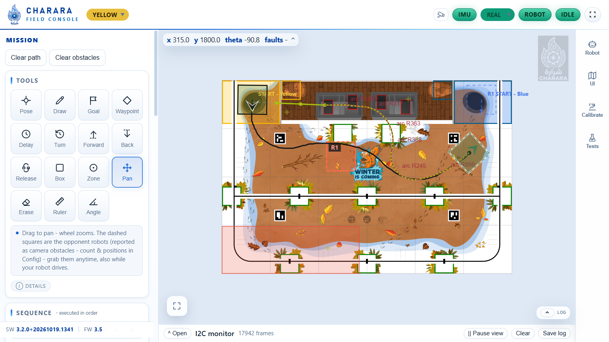
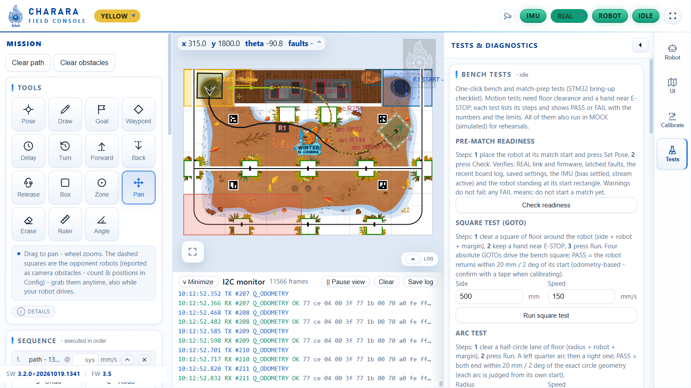
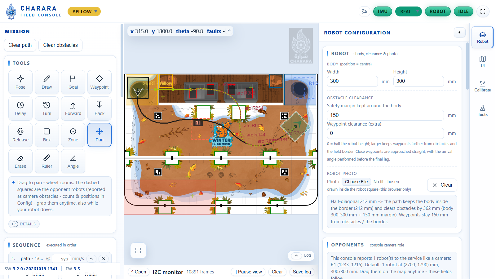
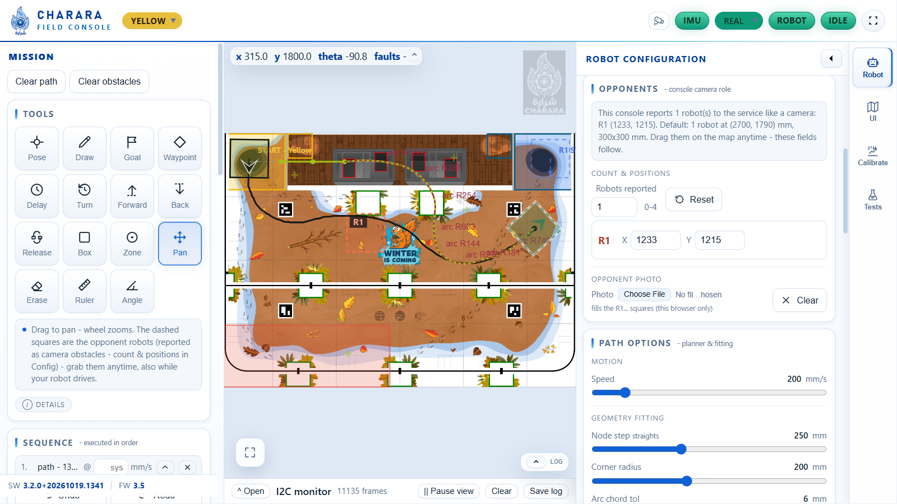
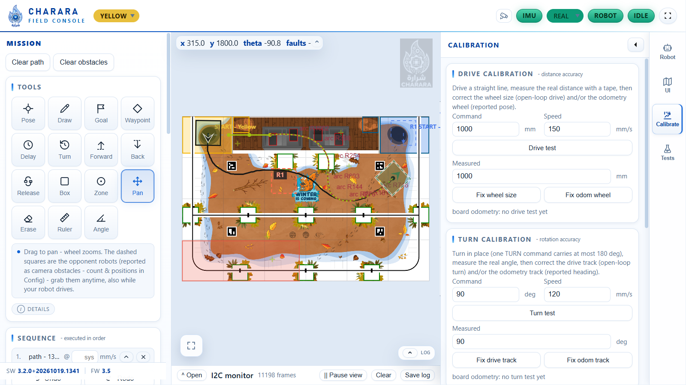
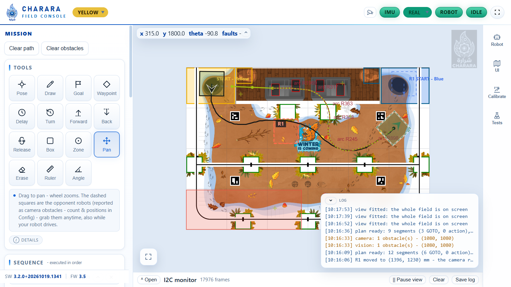
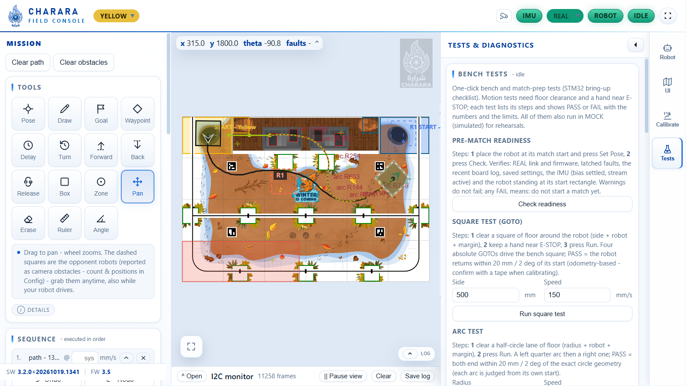

# 04 - Console user guide

The console (`ui/static`, plain HTML/JS/CSS) is the operator interface.
Open `http://<pi>:8080` (docker), `http://<tailnet-name>:8080` (docker, via
the Tailscale `vpn` sidecar) or `http://127.0.0.1:8090` (dev server).

## 1. Screen layout

```
+----------------------------------------------+-------------------------+
| header: WS pill - REAL/MOCK selector -       |                         |
|         ROBOT/state/exec pills + full screen |        field canvas     |
|----------------------------------------------|   (+ dashed camera      |
| Left panel (320 px)                          |    obstacles, ghost,    |
|  Mission tab:  Tools - Sequence - Mission    |    plan preview)        |
|  Config tab:   Geometry - Path options -     |                         |
|                Display - Field               |                         |
|  Calibration:  robot settings - drive/turn   |                         |
|                tests - board error panel     |                         |
|  Clear path / Clear obstacles under the tabs |                         |
+----------------------------------------------|                         |
|              I2C monitor (bottom, collapsible)|                        |
+----------------------------------------------+-------------------------+
```

Telemetry overlay (top-left of the field): `x`, `y`, `theta`, wheel speeds,
active faults - live from the board (or the simulator). It is translucent and
starts collapsed to one line (`x`, `y`, `theta`, faults); the corner chevron
expands it to show the wheel speeds and units (the choice persists). A status
line under the pills reports the board firmware version, the boot reset cause
and the config dirty flag; the board error list lives in the Calibration tab.



## 2. Header pills

| Pill | Meaning |
|---|---|
| **WS** | console <-> service WebSocket |
| **REAL / MOCK** selector | switches the robot link (`POST /api/mode`). Requesting REAL without a board/bus is refused with a hint. Switching is refused while a mission executes. |
| **ROBOT** | board answers on the link |
| **state pill** | motion state (IDLE / DRIVE / TURN / STRAFE / GOTO / ARC / FAULT / E-STOP) |
| **EXEC pill** | execution progress `EXEC running 12/48` |
| **full screen button** (top-right) | toggles browser full screen (the whole console, F11-like); the icon flips to *exit*, Escape leaves too |

## 3. Tools (Mission tab)

| Tool | What it does |
|---|---|
| **Pose** | place the robot *by hand*: click its position, then **drag away from the point to aim the heading - the angle value follows your cursor** (theta pill at the arrow tip). A popup next to the point has editable **X / Y / theta** fields (typing moves the dashed marker live; clamped to the field, theta wrapped to +/-180 deg) and **Validate** (same as *Set Pose*; Enter works too). x or Esc cancels. Validating tells the UI **and** the board where the robot is - nothing moves. |
| **Draw** | freehand/polyline drawing; the start snaps to the robot or the previous path end within 250 mm. Consecutive paths are connected by routed connector legs. The **Draw speed** box sets the per-step speed of the next path(s); empty = the system speed. |
| **Goal** | click to place the goal, drag away to aim the arrival heading theta (also editable by the numeric box in the Mission card). The goal leg is routed around obstacles and the goal is clamped out of the border/obstacle clearance (it is a stop point, like a waypoint). |
| **Waypoint** | click near a path -> the waypoint snaps to its nearest point and **splits the path there**; click away -> free waypoint. **Keep the pointer down and drag away from the point to aim the arrival angle** (exactly like Pose/Goal; the arrow follows the pointer, and `combine with the approach` is enabled). The **Waypoint speed** box sets the per-step speed of the next waypoint(s); empty = system speed. Click an existing waypoint for the popup (X/Y, arrival angle, speed, combine). The robot *sweeps* through waypoints (within ~5 cm) unless `waypoint_cut_mm = 0` (exact crossing). A waypoint is a **stop point** with its own clearance: **Robot > Waypoint clearance** (extra mm over half the robot height; 0 = 150 mm for a 300 mm body). The point is clamped out of the field border and every obstacle's waypoint clearance. A point inside the routing margin is reached by a **straight final leg**; if it is too close to turn in place, an arrival angle is performed at a safe stand-off BEFORE the final leg. If the mission continues from that point, the robot **reaches it exactly**, then reverses (or moves forward) to a turn-safe point, rotates and continues - it never rotates on the tight waypoint. |
| **Delay** | opens a small value box under the tools: enter the hold time in seconds, then **Add delay**. |
| **Turn** | opens the turn box: angle in degrees (positive = CCW, negative = CW), optional speed, then **Add turn**. |
| **Forward / Back** | open the move box: distance in mm, optional speed, then **Add forward** / **Add backward**. The robot drives straight along the heading held at that mission point; Back reverses without turning around. |
| **Release** | opens the release box: **Add release step** inserts a motor-release action in the sequence, **Release now** sends it immediately. Both are allowed only after every movement has completely finished; the drivers turn off without latching E-STOP and the next move re-energizes them automatically. |
| **Box** / **Zone** | drag **static** obstacles. Set them while the robot stands still: the tools **lock while a mission executes** (a message says so). Obstacles are clamped to the game area (the planner clips them too), like waypoints. While the robot runs, moving obstacles are dragged instead (see below). Changing the map while idle re-plans an on-screen plan at once. |
| **Pan** | drag to pan, wheel zooms. `Fit view` (Config) resets. |
| **Erase** | remove paths, obstacles, the goal (sequence steps: x in the list). |
| **Opponent robots** | the dashed squares with ids (`R1`...) - this console **reports them to the service like a camera** (`/ws/vision`, keep-alive every 1.5 s). **Count (0-4) and positions are set in Config > Opponent robots**; default: 1 robot at (2700, 1790) mm. **Drag them anytime, also while your robot drives**: while held, the console streams the position at the **15 Hz camera rate** (even if the pointer is still) and stops on release. The service reacts only when the other robot is **near ours** (~0.7 m) - then it re-routes, or **stops and waits** (`EXEC waiting`) until the way is clear, then continues by itself. If it is dragged **onto the robot**, the run stops immediately (safety stop) and keeps a recoverable wait: move it away and the remaining mission resumes automatically - it is never left permanently stopped. A robot parked on the path **far ahead changes nothing**; it is re-checked as our robot approaches. When a **real camera** streams on the channel, the console yields (robots dimmed "- paused") and that input is used. |
| *(camera)* | other obstacles reported over `/ws/vision` (a real detector) are drawn as **dashed red-orange outlines** - they cannot be edited; they respect their TTL. |

The hint line under the tools explains the active tool; the long description
sits under **Details**, collapsed by default (same for the other cards).

While the pointer is over the map, a translucent chip beside the cursor shows
the **exact table coordinates** (`x`, `y` in mm, one decimal). It turns red
when the pointer is outside the game area. The readout works with every tool,
including Pan and the action boxes.

## 4. Sequence panel

Ordered mission steps, executed in order. Delay, Turn, Forward, Back and
Release are added from the **Tools** card (the value box opens under the tool
grid); paths, waypoints and the goal are added on the map. A **Release** step
runs only after the preceding movement is fully idle; a following move
re-energizes the stepper drivers by itself.

* Every path/waypoint/rotation/pause/move/release row has **x delete** and **^ move**.
* Waypoint **x / y**, rotation **angle**, pause **seconds** are editable inline - each edit updates the ghost preview and marks the plan out of date.
* Paths, waypoints, rotations and moves show their **per-step speed** in the row (`@ ... mm/s`, empty = system speed). It can be changed at any time - after planning, while editing a loaded strategy, or before the next Plan; pressing **Plan** again sends the new speeds.
* **Undo / Redo** for the whole list.
* *Rounding a rotation's angle* makes the ghost glide to that rotation's position and act the turn out.

## 5. Mission card

Three groups, in reading order: **Target**, **Prepare & run** (buttons:
**Plan**, **Set Pose**, **Execute**, **Pause**, **Resume**), **Safety**.

| Control | Effect |
|---|---|
| **Goal theta** | arrival heading of the last node (degrees) |
| **Plan** | plans the mission (`POST /api/plan`). While executing, it is a *re-check*: the remaining route is re-planned only when actually affected (log tells the outcome). |
| **Set Pose** | commits the Pose draft (same as popup *Validate*) |
| **Execute** | runs the last plan; re-pressable to replay it (full-width green button). With `STREAMING_EXEC=1` (and firmware >= 3.4) the same button drives the whole path with the streaming follower - one acceleration, one deceleration, no stop at the junctions; the progress line shows **streaming mode active** with the millimetres left. The follower **aligns in place before driving** when the path lies behind the robot (it never drives forward towards a target behind it) and aborts at the field-edge geofence or when the live pose is > 300 mm off the plan - re-plan from the real pose in that case. The plan's **final heading** (waypoint angle / goal theta) is performed with an in-place turn after the path ends. A plan containing an explicit rotation, pause, **motor release** or **mid-route arrival turn** cannot be encoded as a polyline: Execute uses the segment backend for it and logs *"streaming skipped: this plan performs an in-place rotation, pause, motor release or arrival turn..."*. |
| **Pause / Resume** | stop in place and continue with the next absolute node |
| **Stop** | abort the run (execution stops; the robot holds position) |
| **E-STOP** | latched emergency stop - clear faults afterwards |
| **Clear Faults** | `CLEAR_FAULTS` on the board |
| **Release motors** | turn the stepper drivers off (freewheel) when the robot stands still, to stop the holding torque from draining the battery. It is refused while a mission executes or while the board reports any moving state; it does **not** latch E-STOP, and the next move re-energizes the drivers automatically. The robot may still roll on a slope. |
| plan stats | length, segments, estimated time, primitives, node counts (GOTO / ARC / actions), warnings |

## 6. Drive pad

Single manual commands (DRIVE / TURN / ARC) for wiring checks - refused
while a mission executes. Two value boxes drive the pad: **Distance** (mm,
forward/backward) and **Turn** (deg, +/-180 per command); the captions under
the icons follow the typed values. The **forward / back** arrow-icon buttons
post `/move/drive` by the distance, the two curved-arrow buttons **turn left
(CCW)** / **turn right (CW)** post `/move/turn` by the angle, and the two
**Arc** buttons sweep a 300 mm radius 90 deg to the left or the right
(`POST /api/move/arc`). The speed slider of the Config tab
(100..900 mm/s, the board's absolute ceiling) is used for every pad move.

## 7. I2C monitor

Live frame monitor (`trace` events): TX frames, RX answers, errors, with
sequence id, command/status names and payloads. **Open/Minimize**, **Pause
view** (collection continues), **Clear**, **Save log**. The primary tool to
debug board communication.



## 8. Config tab

Cards, each with small group captions, icon buttons and a collapsed
**Details** fold where a long explanation exists:

* **Robot** - *Body*: width/height (position = centre); *Obstacle
  clearance*: the safety margin; *Robot photo*: file picker with a
  **thumbnail preview** and **Clear**. The photo is drawn inside the robot
  square, which uses exactly the configured width x height; the info box
  shows the derived clearances (half-diagonal, full inflation).
* **Opponents** - the console's camera role: the info box (updated live)
  says when a **real camera stream** has taken over (console paused, robots
  dimmed); *Count & positions*: how many robots it reports (**0-4**,
  **default: 1 robot at (2700, 1790) mm**) and one chip row per robot with
  its X / Y position (300x300 mm each) - the fields and dragging on the
  canvas mirror each other, *Reset* restores the default; *Opponent photo*:
  picker + thumbnail + clear, drawn inside the R1... squares.
  *Photos are downscaled to 512 px and stored in this browser only.*
* **Path options** - *Motion*: speed; *Geometry fitting*: node step
  (straights), corner radius, arc chord tolerance, fit tolerance (caption +
  live value above each slider); *Behaviour*: checkbox chips for fitting,
  obstacle avoidance (Theta*) and corner rounding. The **Details** fold
  explains every option. (Waypoint sweep depth `waypoint_cut_mm` is
  API-level.)
* **Display** - the five drawing colours (drawn path, planned path,
  reference, robot, turns & pauses); the swatches are aligned in one column;
  persisted in the browser (`localStorage`). *Reset colours* restores the
  defaults.
* **Field** - *Size*: width/height + **Apply**; *View*: **Fit view**
  (zoom the map so the whole field fits).





## 9. Calibration tab

Every value here is a **settings register of the board** (see
[05 section 5](05-api-reference.md)): wheel geometry, tracks, speed limits, ramps,
gains and direction masks. Each group's **Apply** writes its values immediately
(the board uses them for the next segment); they are kept in RAM only until
*Save to flash*, so the robot boots with the saved values.



| Block | What it does |
|---|---|
| **Settings groups** | one card per register group (stepper wheels, geometry, odometry encoders, limits, gains, flags), each with its **own action bar**: green triangle = **Apply** (write that group to the board RAM), disk = **Save to flash** (`SAVE_CONFIG`, persists the whole RAM image), undo arrow = **Restore** (re-read that group from the board, discarding its local edits). Hover any button for the exact action; a group with unapplied edits gets an amber frame. Below the groups: **Reload from flash** (`LOAD_CONFIG`, replaces the whole RAM image with the saved record) and **Defaults** (`RESET_CONFIG`, compile-time values in RAM). A dirty marker in the card title shows unsaved board RAM changes. |
| **Flags group** | the orientation calibration: **Motor direction** shows one 0/1 column per wheel (FL, FR, RL, RR - 1 inverts that motor; each column's tooltip names the motor ID, M2/M1/M3/M0), **Encoder direction** shows one 0/1 column per odometry encoder (L, R - 1 inverts that encoder's counting direction), and **Strafe +Y pattern** keeps the mecanum wheel pattern (1 = wheel driven forward on a +Y strafe). Every column is loaded from the board (which reads its flash record at boot), so a single wheel or encoder can be inverted on its own. |
| **Drive test** | commands a measured straight run (`/api/move/drive`) at a chosen speed/distance, watches the telemetry, then shows *board odometry: moved X mm (commanded Y mm)*. Enter the tape measurement and press **Fix wheel size** (stepper wheel diameter) or **Fix odom wheel** (odometry circumference) - the new value is computed as old x measured / commanded (or / reported for odometry). |
| **Turn test** | same for in-place turns (max 180 deg per command): *board odometry: turned X deg (commanded Y deg)* with **Fix drive track** (robot track) and **Fix odom track** (odometry wheel track). |
| **IMU / gyro** | the MPU6050 health (state, yaw axis + mount tilt, bias, live integrated angle, gyro stream frames, whether the board sees a fresh stream) and its calibration tools, all applied live (persist through `docker/.env`): **Reset counter** -> rotate the robot N complete turns by hand -> **Compute & apply scale** (new `GYRO_SCALE` = current x 360 x turns / integrated, applied to the fusion and the board stream at once), **Recalibrate bias** (robot still) and **Measure noise** (suggests `GYRO_SIGMA_DEG_S`). The bias also keeps refining by itself at rest (the live value shows it converging); **Recalibrate bias** re-averages it at once. **Stop IMU (bench test)** / **Start IMU** rehearse an IMU loss without unplugging anything: Stop is safe while the robot moves (the board falls back to wheel heading within ~200 ms, never a fault); Start re-probes the sensor, re-averages the bias and needs the robot standing still. |
| **Acceptance & readiness** | one-click bench and match-prep tests, each with its own steps and a PASS/FAIL line showing the numbers and the limits: **Check readiness** (REAL link + firmware, latched faults, the recent board log, saved settings, IMU bias settled + stream active, robot at its match start; warnings do not fail); **Square test** (four GOTOs, pass = return within 20 mm / 2 deg); **Arc test** (left + right quarter arcs, 20 mm / 2 deg each); **Chain audit** (flat-arc -> quarter-arc -> flat-arc through the executor; pass = zero junction stops, i.e. QUEUE_ARC blending engaged; the closing error is reported); **Rest-drift audit** (N s standing still: board/fused pose drift, encoder tick noise, gyro noise; pass <= 2 mm / 0.5 deg); **Turn repeatability** (N turns per direction: fused mean/sigma/max, board copy and the wheel-vs-gyro scrub per direction; pass |mean| <= 3 deg, sigma <= 1.5 deg); **Loop-drift audit** (closed square loops without corrections: board drift = control+slip, fused drift = estimation, tick scale vs the geometric length; pass <= 60 mm / 4 deg on the last loop); **Speed & ramp audit** (straight run sampled live: real peak/cruise speed, time to 95 %, distance; pass peak within +/-15 %, distance within 60 mm); **Encoder check** (+d, -d, +90 deg turn: tick scale, backward direction, turn polarity and magnitude match); **Fault drills** (E-stop rehearsal: latch + clear, no motion; Deadman drill: a slow creep while telemetry AND the gyro stream go silent for the window - any received frame would feed the watchdog - so the board must stop ITSELF at the 1.5 s watchdog and latch DEADMAN; MOVES the robot, clear floor required; the drill clears the fault before returning). Motion tests refuse while a mission executes or with latched faults, arm the deadman while they run, and all tests also run in MOCK (results say MOCK). |
| **Board errors** | the decoded board event log (`GET /api/errors`): newest first, with code, name, severity and the context byte - faults, bad frames, rejected parameters, flash errors, config fallbacks, reset causes. Refreshes with the diagnostics poll. |

Workflow: run a drive test, measure, press the fix button (it writes the new
register value to the board right away), re-run to confirm, then **Save to
flash**. Same for a 90 deg turn test. To fix a wheel spinning the wrong way,
open **flags > Motor direction** and set its column to 1; a reversed odometry
encoder uses the **Encoder direction** columns the same way - apply the flags
group, re-check with the tests, save to flash. For the gyro: **Reset counter**,
turn the robot N complete turns by hand, enter N and **Compute & apply scale**;
the note under the buttons shows the exact `GYRO_SCALE=...` line to add to
`docker/.env` (values apply live but restart from the environment).

## 10. Reading the canvas

| Layer | Look |
|---|---|
| drawn mission | your stroke color (default amber), thin |
| ghost robot | semi-transparent square (same size as the robot box) = where the commands leave the robot (rotations acted out) |
| plan preview | cyan path + node dots; grey dashed = fitted reference; arcs drawn as a dashed overlay labeled `arc R##`; turns/pauses/releases labeled |
| robot | solid square (config Width x Height, rotated with the heading) with the **front chevron inside it**, robot color; a photo fills the square when one is set; red when faulted |
| obstacles | solid red outlines (console boxes/zones), **dashed orange-red with ids `R1`...** (the opponent robots this console reports - dimmed while a real camera streams), other dashed orange-red (a real camera) |
| mock watermark | yellow "MOCK - SIMULATED ROBOT" |

## 11. Warnings & logs



Warnings appear in the plan stats block and the log. The complete catalogue is
in [03 section 11](03-planner-algorithms.md). The most common ones:

* *"obstacle change does not affect the remaining route - trajectory
  unchanged"* - nothing was necessary, the robot kept driving.
* *"dynamic obstacle - the robot stopped at (x, y) mm and the remaining route
  was re-planned (N segments): it re-routes and continues"* - the swap ran.
* *"vision: N obstacle(s) - (x, y)"* - a camera report changed the map.
* *"moving obstacle blocks the remaining route - waiting for it to clear (...)"*
  - the robot stopped and **waits**; move the blocking robot away (or let its
  report expire) and the log shows *"the route is clear again - resuming the
  mission (N segments)"* as it continues on its own. The pill reads `EXEC
  waiting` meanwhile.
* *"waypoint (x, y) mm sits inside the robot clearance zone - moved to the
  closest allowed point (x, y) mm"* - a stop point cannot stand inside the
  safety margin; it was projected to the boundary and the route goes there.
* *"leg i re-routed to stay clear (obstacle or field border)"* - the drawn
  leg entered the safety margin; the detour keeps the full clearance.
  *"…squeezed through the obstacle margin…"* / *"…re-routed at body
  clearance…"* mean the corridor was too tight for the full margin: those
  are the only cases where the robot drives closer than configured.

## 12. Typical workflows



**Place the robot**
1. **Pose** -> click the robot's table position -> drag to aim theta (watch the theta
   pill) -> fine-tune X/Y/theta in the popup -> **Validate**.

**Build and run a mission**
1. **Draw** the first path (start snaps to the robot).
2. Add **+ Rotation / + Pause** as needed, draw the next path (it snaps to
   the previous end), place **waypoints**, set a **goal**.
3. **Plan** -> inspect the preview and warnings -> **Execute >**.
4. Watch progress (EXEC pill, ghost, log). **Pause/Resume/Stop** any time.

**React to something on the table**
* Console, static: draw a **Box** where the obstacle is (while the robot
  stands still). If the robot is running and its *remaining* route is affected
  it stops, re-routes (shortest detour) and continues - otherwise nothing
  changes.
* Opponent robots (dynamic): **drag the opponent robots** (`R1`... in Config) -
  also while the robot drives. The
  service reacts only when one gets **close to your robot** (~0.7 m): it
  detours when that is short, otherwise it **waits** for the way to clear
  (move the robot away) and continues by itself. A robot left on the path far
  ahead changes nothing until your robot approaches it.
* Camera: nothing to do - reports arrive over `/ws/vision` and behave the
  same (dashed outlines, logs, re-check, wait). A real camera **replaces the
  console's robots** while it streams (the console yields, robots dimmed).

**Calibrate the robot (Calibration tab)**
1. **Drive test**: type distance (e.g. 1000 mm) and speed (e.g. 150 mm/s),
   press the button, wait for the stop message.
2. Measure the real distance with a tape, enter it in **Measured**, press
   **Fix wheel size** (distance scale) - repeat with **Fix odom wheel** if the
   *board reported* distance is off.
3. **Apply**, rerun the test to confirm, then **Save to flash**.
4. **Turn test** (<= 180 deg): same loop with **Fix drive track** and **Fix
   odom track** for rotation accuracy.

**If the robot stops and doesn't continue**
* Read the fault in the log (STALL/TIMEOUT come from the board) -> *Clear
  Faults*; the Calibration tab's board error panel shows the same fault with
  its context byte (which switch, which segment state).
* A stop immediately followed by *"dynamic obstacle ..."* is *intentional* -
  the route was re-planned; execution continues automatically.

## 13. Troubleshooting

| Symptom | Check |
|---|---|
| No telemetry (pills red) | service reachable? `curl /api/health`; in docker: `docker compose logs api` |
| Field artwork missing | `ui/static/field/table.png` present? replace it (or delete it, drop in the PDF and rebuild the `ui` image - see `../README.md`) |
| First path not rounded | the joint to the connector needs a vertex near it; check the *kept sharp* warning |
| Robot cuts a curve | lower **Arc chord tol** (e.g. 4) and/or raise **Corner radius**; **Node step** only affects straights |
| Plan out of date bar | any edit invalidates the plan - press **Plan** |
| Calibration rejected (`422`) | value outside the register range - the input tooltip lists min/max |
| Board shows `CONFIG_FALLBACK` | the flash record was invalid (interrupted save or manual write); check the board error panel and press **Save to flash** again to rewrite it |
| Settings lost after reboot | the edits were applied but never saved - press **Save to flash** |
| UI looks unchanged after an update | hard reload - assets are versioned (`?v=N` in `index.html`) |
