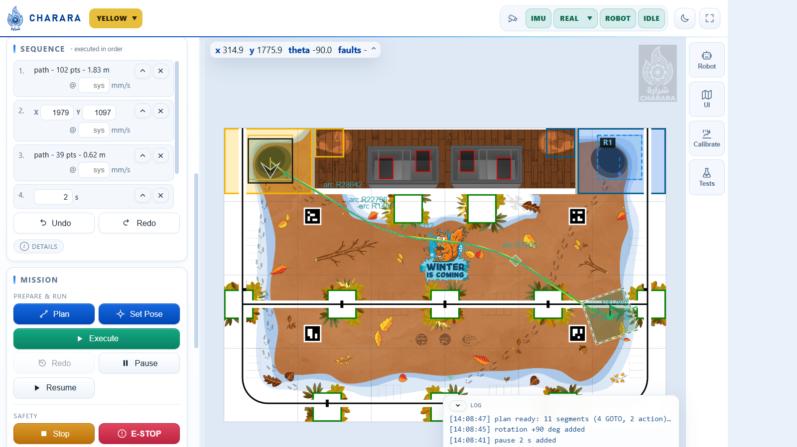
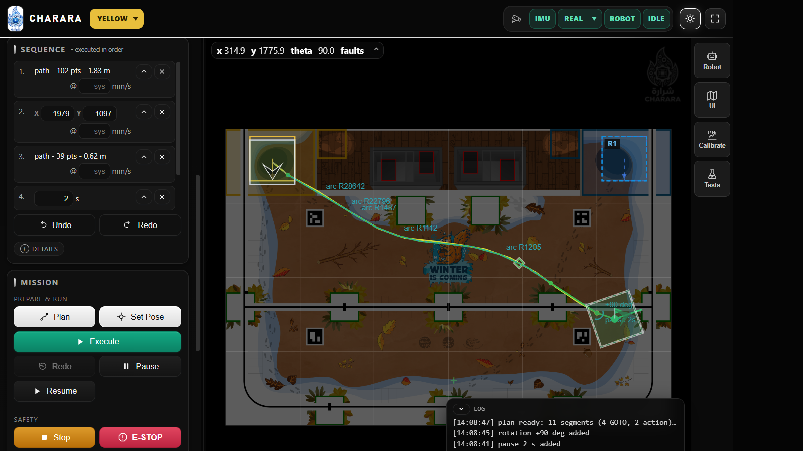
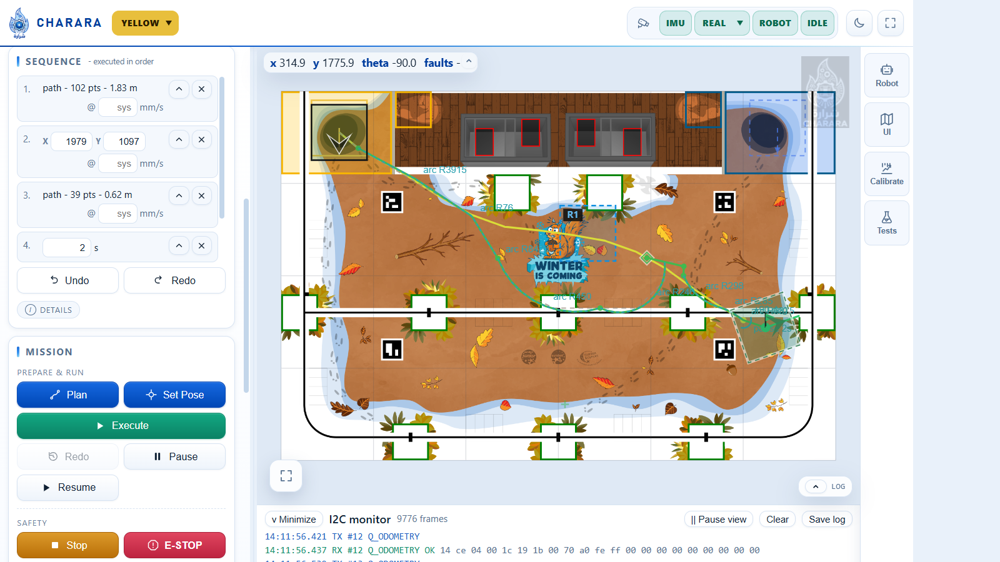
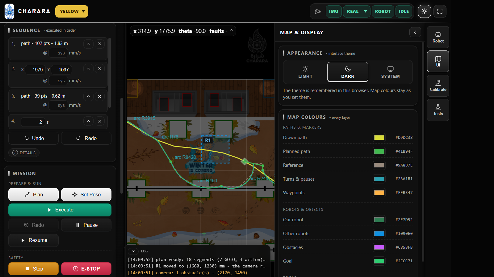
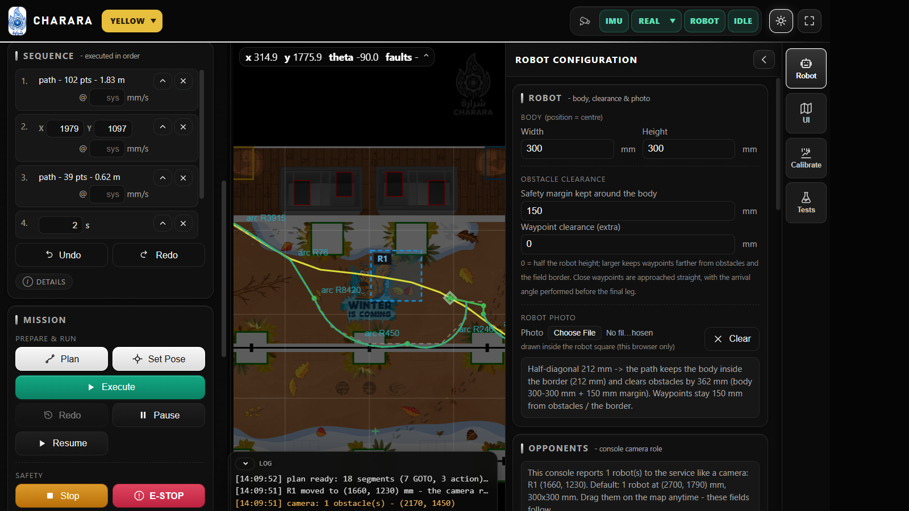
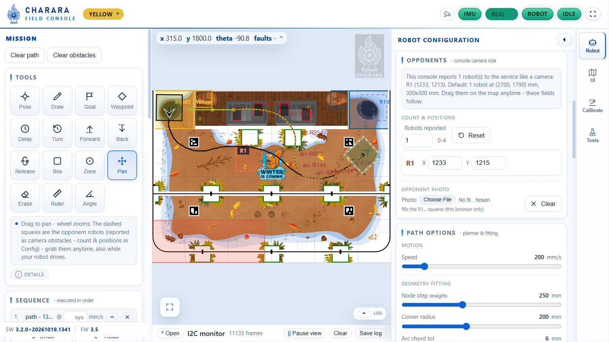
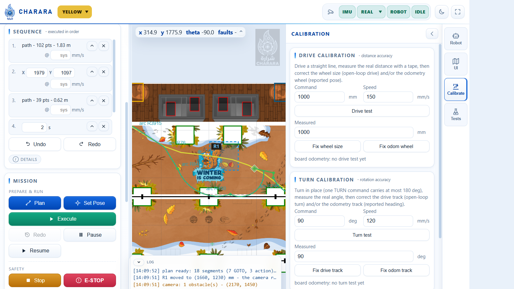
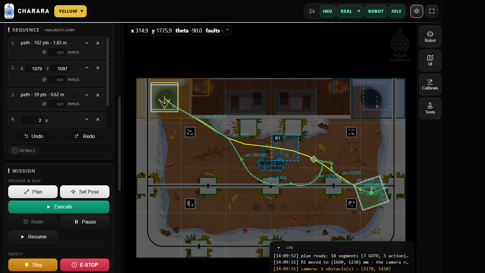
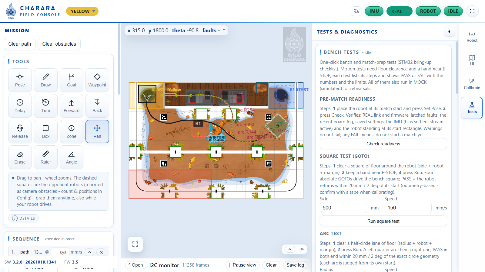

# 04 - Console user guide

The console (`ui/static`, plain HTML/JS/CSS) is the operator interface.
Open `http://<pi>:8080` (docker), `http://<tailnet-name>:8080` (docker, via
the Tailscale `vpn` sidecar) or `http://127.0.0.1:8090` (dev server).

## 1. Screen layout

```
+----------------------------------------------+-------------------------+
| header: brand - team - status cluster -      |                         |
|         theme/full screen actions            |        field canvas     |
|----------------------------------------------|   (+ dashed camera      |
| Left panel (resizable, 320 px default)       |    obstacles, ghost,    |
|  Mission:  Tools - Sequence - Mission        |    plan preview)        |
|  Clear path / Clear obstacles                |                         |
|                                              | Settings rail (right):  |
|                                              |  Robot - UI - Map -     |
|                                              |  Calibrate - Tests      |
+----------------------------------------------+-------------------------+
|              I2C monitor (bottom, collapsible)|                        |
+----------------------------------------------+-------------------------+
```

The **mission panel** can be widened or narrowed: hover its right border
until the `col-resize` cursor and the grip appear, then drag it (250-620 px).
Double-click the border to restore 320 px; focus it and use the arrow keys
(Shift = bigger steps) for fine adjustments. The width is remembered in the
browser. The tool grid stays inside the panel at every width: it keeps four
columns normally and drops to three when the panel is narrow.

Telemetry overlay (top-left of the field): `x`, `y`, `theta`, wheel speeds,
active faults - live from the board (or the simulator). It is translucent and
starts collapsed to one line (`x`, `y`, `theta`, faults); the corner chevron
expands it to show the wheel speeds and units (the choice persists). A status
line under the pills reports the board firmware version, the boot reset cause
and the config dirty flag; the board error list lives in the Calibration tab.



The same session in the **dark theme** - the carbon-black palette the console
switches to with one click (see *Appearance* in section 8):



## 2. Header status cluster

The header groups the camera, IMU, link mode, robot link, motion state and
execution progress in **one recessed status strip**, with the theme and full
screen actions at the far right. The strip is compact on wide screens and moves
to its own row below the brand when the window is narrow (the header grows to
two rows; under 380 px the execution chip can add a third). No item is clipped
or turned into a circle at any width.

| Item | Meaning |
|---|---|
| **camera** | vision channel: green when a real camera owns `/ws/vision`, neutral while the console reports the opponent robots, red when the service link is down |
| **IMU** | MPU6050 health: green = ready, amber = calibrating, neutral = unavailable (wheel-only heading) |
| **REAL / MOCK** selector | switches the robot link (`POST /api/mode`). Requesting REAL without a board/bus is refused with a hint. Switching is refused while a mission executes. |
| **ROBOT** | board answers on the link |
| **state** | motion state (IDLE / DRIVE / TURN / STRAFE / GOTO / ARC / FAULT / E-STOP) |
| **EXEC** | execution progress `EXEC running 12/48`; hidden while idle |
| **task timer** | a stopwatch pill in the status row: the duration the plan is **expected** to take (`≈ 7.40 s`, from the last plan - so it follows drawing, waypoints, a loaded strategy…), then, from the **Execute** press, a clock that starts at **0.00 s** and runs while the task executes; it **freezes on the final time** when the run ends (a mid-run re-plan or a wait keeps counting - the task is not over). Indigo with a turning dial while it runs, slate when it idles (never the "all good" green of the status pills). `mm:ss.cc` from one minute up |
| **game timer** | the match clock configured in **Game > Game time**: remaining time (overtime shows `+`), teal while running, **red inside the configured warning window** and solid red at the limit. In MOCK overtime the red pill keeps a `!` warning mark because the run continues; a REAL run is stopped. Hidden when the duration is 0. |
| **full screen** (top-right) | toggles browser full screen (the whole console, F11-like); the icon flips to *exit*, Escape leaves too |
| **moon / sun** (top-right) | switches between the light and dark interfaces; the UI tab's **Appearance** group also offers **System** (follows the operating system). The choice is stored in the browser. |

## 3. Tools (Mission tab)

| Tool | What it does |
|---|---|
| **Pose** | place the robot *by hand*: click its position, then **drag away from the point to aim the heading - the angle value follows your cursor** (theta pill at the arrow tip). A popup next to the point has editable **X / Y / theta** fields (typing moves the dashed marker live; theta wrapped to +/-180 deg) and **Validate** (same as *Set Pose*; Enter works too). x or Esc cancels. Validating tells the UI **and** the board where the robot is - nothing moves. The point follows the **Pose clearance** (Robot tab, default 0): like a waypoint it may stand with the robot **edge on the field border** and is pushed out of the drawn obstacles by the same margin. |
| **Draw** | freehand/polyline drawing; the start snaps to the robot or the previous path end within 250 mm. Consecutive paths are connected by routed connector legs. The **Draw speed** box sets the per-step speed of the next path(s); empty = the system speed. |
| **Goal** | click to place the goal, drag away to aim the arrival heading theta. A popup opens next to the marker with editable **X / Y / theta** (empty theta = no arrival heading) plus **Apply**, delete and close (Enter applies, Esc closes without touching the goal). Clicking an already placed goal - with any tool except Erase and Goal - reopens the same popup; drag pans the map as usual when the goal is only clicked. The goal leg is routed around obstacles and the goal is clamped out of the border/obstacle clearance (it is a stop point, like a waypoint). |
| **Waypoint** | click near a path -> the waypoint snaps to its nearest point and **splits the path there**; click away -> free waypoint. **Keep the pointer down and drag away from the point to aim the arrival angle** (exactly like Pose/Goal; the arrow follows the pointer, and `combine with the approach` is enabled). The **Waypoint speed** box sets the per-step speed of the next waypoint(s); empty = system speed. Click an existing waypoint for the popup (X/Y, arrival angle, speed, combine). The robot *sweeps* through waypoints (within ~5 cm) unless `waypoint_cut_mm = 0` (exact crossing). A waypoint is a **stop point** with its own clearance: **Robot > Waypoint clearance** (extra mm over half the robot height; 0 = 150 mm for a 300 mm body). The point is clamped out of the field border and every obstacle's waypoint clearance. A point inside the routing margin is reached by a **straight final leg**; if it is too close to turn in place, an arrival angle is performed at a safe stand-off BEFORE the final leg. If the mission continues from that point, the robot **reaches it exactly**, then reverses (or moves forward) to a turn-safe point, rotates and continues - it never rotates on the tight waypoint. |
| **Delay** | opens a small value box under the tools: enter the hold time in seconds, then **Add delay**. |
| **Turn** | opens the turn box: angle in degrees (positive = CCW, negative = CW), optional speed, then **Add turn**. |
| **Forward / Back** | open the move box: distance in mm, optional speed, then **Add forward** / **Add backward**. The robot drives straight along the heading held at that mission point; Back reverses without turning around. |
| **Release** | opens the release box: **Add release step** inserts a motor-release action in the sequence, **Release now** sends it immediately. Both are allowed only after every movement has completely finished; the drivers turn off without latching E-STOP and the next move re-energizes them automatically. **Release now** first expands a small inline confirmation card below the buttons (UI-styled, Cancel / Escape closes) - no browser dialog. |
| **Box** / **Zone** / **Polygon** | drag a rectangle (**Box**), drag out a circle (**Zone** - centre + radius), or click the points of a **Polygon** shape (the points are joined in order and the last one **closes the shape back to the first** - finish with **Enter**, a **double-click** or a click on the first point, **Esc** cancels). The box under the tools chooses the obstacle **type**: **Permanent** (fixed table fixture, anonymous) or **Game element** (movable; the required **name** A/B/... is painted on the map as a chip). Game elements also choose **Game element: Place now / Spawn step**. **Place now** is immediate: the drawn shape is the marker's new position (drawing an existing name moves that piece). **Spawn step** is programmable: the drawn shape becomes the destination of a spawn action and the map marker keeps its **initial** position until the robot reaches that step - a dashed preview shows where the piece will be created. Permanent obstacles never get that choice: they are only created at the setup and are never adjusted or scheduled. Shapes are clamped to the game area. **Once the sequence has steps, permanent obstacles are locked** (no create/edit/delete); game elements stay editable. All obstacle tools **lock while a mission executes** - use the sequence's **Erase element** / **Spawn element** steps for game pieces during a run. **Click any existing obstacle to edit it**: a popup shows the type/name and the **X / Y / W / H** of a box, the **centre X / Y and radius** of a zone, or **one X / Y row per vertex** of a polygon - Apply moves it and re-plans, the bin removes it (game elements only once the sequence started). The same editor opens with **Pan** (click without dragging) and with each of the three tools. Changing the map while idle re-plans an on-screen plan at once. |
| **Pan** | drag to pan, wheel zooms. `Fit view` (Config) resets. |
| **Erase** | remove paths, obstacles (permanent fixtures only while no sequence has steps), the goal (sequence steps: x in the list). The **Game element click** box chooses **Delete now** (the marker disappears immediately) or **Add erase step** (programmable: the marker stays on the map and the route keeps avoiding it until the robot reaches that step). Permanent obstacles are always **Delete now** - they are never scheduled. |
| **Opponent robots** | the dashed squares with ids (`R1`...) - this console **reports them to the service like a camera** (`/ws/vision`, keep-alive every 1.5 s). **Count (0-4) and positions are set in Config > Opponent robots**; default: 1 robot at (2700, 1790) mm. **Drag them anytime, also while your robot drives**: while held, the console streams the position at the **15 Hz camera rate** (even if the pointer is still) and stops on release. The service reacts only when the other robot is **near ours** (~0.7 m) - then it re-routes, or **stops and waits** (`EXEC waiting`) until the way is clear, then continues by itself. If it is dragged **onto the robot**, the run stops immediately (safety stop) and keeps a recoverable wait: move it away and the remaining mission resumes automatically - it is never left permanently stopped. A robot parked on the path **far ahead changes nothing**; it is re-checked as our robot approaches. When a **real camera** streams on the channel, the console yields (robots dimmed "- paused") and that input is used. |
| *(camera)* | other obstacles reported over `/ws/vision` (a real detector) are drawn as **dashed red-orange outlines** - they cannot be edited; they respect their TTL. |

**Game elements in the sequence** - the Sequence card has a game-element
picker plus **Erase element** and **Spawn element**. Both are **programmable**:
the map marker does not change when the step is added. **Erase element** lets
the route pass through the piece's old spot after that step; **Spawn element**
starts a placement: a dashed outline of the piece follows the pointer, a click
on the map drops the destination and appends the spawn step (Esc cancels). The
sequence row also carries the destination **X / Y**, so it can be fine-tuned
later. The same programmable placement is available from the Box / Zone /
Polygon tool with **Game element: Spawn step**; **Place now** stays the
immediate edit. The planner routes every leg on the obstacle map that is there
at that point of the mission, e.g. drive to `A`, erase `A`, drive through,
then spawn `A` somewhere else. During the run the service updates its live
obstacle map at each action and the console's marker follows (the dashed
preview disappears once the real marker matches it), so a later camera
re-plan sees the right pieces. A spawn step stores its destination geometry,
so the piece does not need to be on the map to be placed back. **Permanent
table fixtures are never programmable**: they are created once at the setup,
can only be deleted immediately (and are locked once the sequence starts), so
they can never be erased or re-spawned by a strategy.

The hint line under the tools explains the active tool; the long description
sits under **Details**, collapsed by default (same for the other cards).

While the pointer is over the map, a translucent chip beside the cursor shows
the **exact table coordinates** (`x`, `y` in mm, one decimal). It turns red
when the pointer is outside the game area. The readout works with every tool,
including Pan and the action boxes.

## 4. Sequence panel

Ordered mission steps, executed in order. Delay, Turn, Forward, Back and
Release are added from the **Tools** card (the value box opens under the tool
grid); paths, waypoints and the goal are added on the map. A **Release** step
runs only after the preceding movement is fully idle; a following move
re-energizes the stepper drivers by itself.

* Every path/waypoint/rotation/pause/move/release row has **x delete** and **^ move**.
* The list adapts to a narrow panel: the description wraps (waypoint axes stay
  together and are labeled **X / Y**) while the move/delete buttons keep their
  column, so values never slide under the controls.
* Waypoint **x / y**, rotation **angle**, pause **seconds** are editable inline - each edit updates the ghost preview and marks the plan out of date.
* Paths, waypoints, rotations and moves show their **per-step speed** in the row (`@ ... mm/s`, empty = system speed). It can be changed at any time - after planning, while editing a loaded strategy, or before the next Plan; pressing **Plan** again sends the new speeds.
* **Undo / Redo** for the whole list.
* *Rounding a rotation's angle* makes the ghost glide to that rotation's position and act the turn out.

## 5. Mission card

Two groups, in reading order: **Prepare & run** (buttons: **Plan**,
**Set Pose**, **Execute**, **Pause**, **Resume**) and **Safety**. The goal is
edited on the map (placing or clicking it opens the goal popup - see the
*Goal* tool), so the card no longer carries a numeric target box.

| Control | Effect |
|---|---|
| **Plan** | plans the mission (`POST /api/plan`). While executing, it is a *re-check*: the remaining route is re-planned only when actually affected (log tells the outcome). |
| **Set Pose** | commits the Pose draft (same as popup *Validate*) |
| **Execute** | runs the last plan; re-pressable to replay it (full-width green button). With `STREAMING_EXEC=1` (and firmware >= 3.4) the same button drives the whole path with the streaming follower - one acceleration, one deceleration, no stop at the junctions; the progress line shows **streaming mode active** with the millimetres left. The follower **aligns in place before driving** when the path lies behind the robot (it never drives forward towards a target behind it) and aborts at the field-edge geofence or when the live pose is > 300 mm off the plan - re-plan from the real pose in that case. The plan's **final heading** (waypoint angle / goal theta) is performed with an in-place turn after the path ends. A plan containing an explicit rotation, pause, **motor release** or **mid-route arrival turn** cannot be encoded as a polyline: Execute uses the segment backend for it and logs *"streaming skipped: this plan performs an in-place rotation, pause, motor release or arrival turn..."*. |
| **Pause / Resume** | stop in place, then **Resume finishes the node that was interrupted**: the remaining arc sweep / turn / distance is re-sent from the live pose, so the plan goes on exactly where it stopped (the run used to skip that node and the next one started from a pose the plan never expected - every relative ARC then bent the path). **Pause also freezes both counters** (task timer and match clock); **Resume** continues them from the frozen value |
| **Redo (paused)** | while the run is **paused**, **Redo** lights up (indigo): it **ends the paused run** and puts the robot **back at the start of the sequence** (the pose it had when Execute was pressed), so **Execute** replays the whole path from the beginning - exactly like Redo after a finished run. **Redo restarts the counters**: the task timer and the match clock go back to zero, and the next Execute starts them again. Resume, on the other hand, continues where the robot stopped |
| **Stop** | abort the run (execution stops; the robot holds position) |
| **E-STOP** | latched emergency stop - clear faults afterwards |
| **Clear Faults** | `CLEAR_FAULTS` on the board |
| **Release motors** | turn the stepper drivers off (freewheel) when the robot stands still, to stop the holding torque from draining the battery. It is refused while a mission executes or while the board reports any moving state; it does **not** latch E-STOP, and the next move re-energizes the drivers automatically. The button first opens a small inline confirmation card below it (UI-styled; Cancel or Escape closes) and sends nothing until **Release** is pressed. The robot may still roll on a slope. |
| plan stats | length, segments, estimated time, primitives, node counts (GOTO / ARC / actions), warnings |

## 6. Drive pad

Single manual commands (DRIVE / TURN / ARC) for wiring checks - refused
while a mission executes. Two value boxes drive the pad: **Distance** (mm,
forward/backward) and **Turn** (deg, +/-180 per command); the captions under
the icons follow the typed values. The **forward / back** arrow-icon buttons
post `/move/drive` by the distance, the two curved-arrow buttons **turn left
(CCW)** / **turn right (CW)** post `/move/turn` by the angle, and the two
**Arc** buttons sweep a 300 mm radius 90 deg to the left or the right
(`POST /api/move/arc`). The speed slider of the Config tab
(100..900 mm/s, the board's absolute ceiling) is used for every pad move.

## 7. I2C monitor

Live frame monitor (`trace` events): TX frames, RX answers, errors, with
sequence id, command/status names and payloads. **Open/Minimize**, **Pause
view** (collection continues), **Clear**, **Save log**. The primary tool to
debug board communication.



## 8. Config tab

Cards, each with small group captions, icon buttons and a collapsed
**Details** fold where a long explanation exists:

* **Robot** - *Body*: width/height (position = centre); *Obstacle
  clearance*: the safety margin, the **waypoint clearance (extra)**, the
  **pose clearance (extra)** (both 0 = half the larger body side, so a
  placed pose or a waypoint may stand with the robot edge on the border) and
  the **turn clearance (extra)** - added to the body's diagonal, it is the
  room a planned in-place turn needs, so the straight escape at the start
  and the departure move after a close waypoint get longer by the same
  amount (default 30 mm);
  *Robot photo*: file picker with a **thumbnail preview** and **Clear**. The
  photo is drawn inside the robot square, which uses exactly the configured
  width x height; the info box shows the derived clearances (half-diagonal,
  full inflation).
* **Opponents** - the console's camera role: the info box (updated live)
  says when a **real camera stream** has taken over (console paused, robots
  dimmed); *Count & positions*: how many robots it reports (**0-4**,
  **default: 1 robot at (2700, 1790) mm**) and one chip row per robot with
  its X / Y position **and heading θ** (300x300 mm each; the id `R1` is
  painted on the front face and turns with it) - the fields and dragging on
  the canvas mirror each other, *Reset* restores the default; *Opponent
  photo*: picker + thumbnail + clear, drawn inside the R1... squares.
  *Photos are downscaled to 512 px and stored in this browser only.*
* **Path options** - *Motion*: speed; *Geometry fitting*: node step
  (straights), corner radius, arc chord tolerance, fit tolerance (caption +
  live value above each slider); *Behaviour*: checkbox chips for fitting,
  obstacle avoidance (Theta*) and corner rounding. The **Details** fold
  explains every option. (Waypoint sweep depth `waypoint_cut_mm` is
  API-level.)
* **Appearance** - the interface theme: **Light**, **Dark** or **System**. The
  choice is remembered in the browser; the header moon/sun button toggles
  light/dark from anywhere. Dark mode uses a neutral carbon-black palette (no
  navy/blue tint), dims the table artwork and switches the panels, cards, log
  and overlays to black and graphite.
* **Map colours** - every drawing colour: drawn path, planned path, reference,
  turns & pauses, waypoints, **our robot**, **other robots (the red camera
  squares)**, obstacles, goal, ruler/angle and the pose marker. Each row shows
  the swatch and its hex value; changes are persisted in the browser
  (`localStorage`) and apply live. *Reset all colours* restores the defaults.
* **Layer opacity** - the transparency of **our robot**, the **other robots**
  (camera squares and reports) and the **obstacles**, one slider per layer
  (0-100 %, readout next to it). **100 % is a solid shape painted in the
  layer's colour** - lower the slider to let the field artwork and the planned
  path show through (the default look of the console is a fully solid layer).
  Double-click a slider to make that layer solid again, or press *Reset
  transparency*. Stored next to the colours in the browser (`localStorage`,
  key `charara.opacity`) and applied live - the obstacle-drawing previews stay
  outlined while you drag, whatever the setting.
* **Game** - a shortcut to the **Game** tab of the settings rail
  (table size, background artwork, match clock, timed actions, starting
  zones and their colours).







## 9. Game Configuration tab

Everything that makes the console fit a **different game** lives in one
place: the **Game** tab of the settings rail, between **UI** and
**Calibrate**. It edits a small persisted document
(`MAP_CONFIG_FILE`, default `<repo>/map/map.json`; `/data/map/map.json` in
docker), so the table size, the artwork, the match clock, the timed actions
and the starting zones survive restarts and redeploys.

* **Field - size & artwork** - *Play area*: width/height + **Apply size**
  (the zones are re-clamped inside the new table instead of being lost).
  *Background artwork*: every image **and PDF** found in `ui/static/field`
  is listed - pick one and the map redraws at once; **Automatic** keeps the
  `table.png -> table.jpg -> field-default.svg` search order. The PDFs
  Eurobot publishes can be selected as-is: the service rasterises **page 1**
  to a ~3000 px PNG on first use (poppler `pdftoppm`, a few seconds) and
  caches it under `MAP_CACHE_DIR` (`/data/map/cache` in docker), so the next
  load is instant and the browser never downloads the vector file.
  **Rescan** picks up a file you just copied into the folder; **Fit view**
  zooms the whole field.
  *Background opacity*: a 0-100 % slider under the picker fades the artwork
  (remembered in this browser) so a busy printed table stops fighting with
  the drawn mission and the planned path; double-click the slider (or drag it
  back) for the full table.
* **Game time - match clock & timed actions** - set the **game duration**
  (default 100 s; 0 disables the clock) and the **red warning window**
  (default the last 10 s). **Save clock** persists it; **Start clock** starts
  it now; **Reset** rewinds it and re-arms the timed actions. Execute also
  starts the clock automatically. The clock is server-side; **Pause freezes
  it**, **Resume continues it** and **Redo rewinds it** together with the
  task timer. At the limit, a **REAL** run stops immediately and refuses a
  restart until Reset; **MOCK** keeps running and the header game pill shows
  the red overtime warning/mark.
  *Timed actions* fire once per clock run at an **elapsed** second (for
  example 95 s): add a row, choose **Log** (writes the event log now) or
  **REST call** (the reserved actuator bridge - configurable and dispatched
  through a pluggable handler, but no network call yet), then **Save
  actions**. The architecture and a handler example are in
  [11-game-time.md](11-game-time.md).
* **Starting zones** - press **Start zone**, then **drag a rectangle** on the
  map. A popup opens (the same pattern as the waypoint editor) with:
  * **team** (Yellow / Blue) and **type**: **Primary** (the main robot) or
    **Secondary** (the small/secondary robot),
  * the rectangle's **X / Y / W / H** in mm,
  * for a **primary** zone only, the **robot spawn pose**: X, Y and theta -
    the exact pose the robot starts the match from inside the rectangle
    (**Centre of the zone** snaps it to the middle).

  The list under the card shows every zone with its colour, size and spawn;
  click a row (or the zone on the map) to edit it, the bin deletes it. The
  **erase** tool removes a zone too. A primary zone's spawn **owns its team's
  match start**: the header, the MOCK placement and the rehearsal scenario
  follow it (`TEAM_START_*` is only the fallback when no zone exists).
* **Zone colours** - one colour per team; every zone is painted in its team
  colour, and a primary zone draws the robot spawn body + heading marker.
  The colours are stored in the map document (not per browser).

The zones are configuration, **not obstacles**: the planner ignores them. A
zone may extend to the table border; a spawn is clamped inside its own
rectangle by the service, so a hand-edited file can never place the robot
outside its start box.

**Saving a zone places the robots in it.** The start zone *is* the match
start, so when you save the zones the service puts **our robot** at the
current team's primary spawn (the MOCK simulator is teleported, like a team
switch); on the REAL robot the console never moves the board - the log tells
you the pose to place by hand, then press **Set Pose**. **R1** (the console's
reported opponent) is moved into the opponent's primary zone on the map at
the same time. A running mission is never disturbed: the new start applies
from the next run. The **Check readiness** test follows the zones too (a
`start zones` row says whether both teams are configured, and `start pose`
measures against the zone spawn).

**Reset robot to start** (button under the zone list) puts the robot back on
that start at any time: `POST /api/pose/start` teleports the MOCK simulator,
and on the REAL robot the log gives the pose to adopt with **Set Pose**. The
line under the button always shows the current start pose of our side.

**Switching side mirrors the mission.** A team change does more than move the
robots: paths, waypoints (position and arrival heading), rotations, the goal
and the drawn obstacles are reflected about the table's centre line
(`x -> W - x`, heading -> `180 - theta`, rotations negated) - exactly the
transformation a strategy authored for the other side gets when it is loaded.
**R1** is placed in the opponent start **facing our robot**, so its id (painted
on its front face) points at us.

## 10. Calibration tab

Every value here is a **settings register of the board** (see
[05 section 5](05-api-reference.md)): wheel geometry, tracks, speed limits, ramps,
gains and direction masks. Each group's **Apply** writes its values immediately
(the board uses them for the next segment); they are kept in RAM only until
*Save to flash*, so the robot boots with the saved values.



| Block | What it does |
|---|---|
| **Settings groups** | one card per register group (stepper wheels, geometry, odometry encoders, limits, gains, flags), each with its **own action bar**: green triangle = **Apply** (write that group to the board RAM), disk = **Save to flash** (`SAVE_CONFIG`, persists the whole RAM image), undo arrow = **Restore** (re-read that group from the board, discarding its local edits). Hover any button for the exact action; a group with unapplied edits gets an amber frame. Below the groups: **Reload from flash** (`LOAD_CONFIG`, replaces the whole RAM image with the saved record) and **Defaults** (`RESET_CONFIG`, compile-time values in RAM). A dirty marker in the card title shows unsaved board RAM changes. |
| **Flags group** | the orientation calibration: **Motor direction** shows one 0/1 column per wheel (FL, FR, RL, RR - 1 inverts that motor; each column's tooltip names the motor ID, M2/M1/M3/M0), **Encoder direction** shows one 0/1 column per odometry encoder (L, R - 1 inverts that encoder's counting direction), and **Strafe +Y pattern** keeps the mecanum wheel pattern (1 = wheel driven forward on a +Y strafe). Every column is loaded from the board (which reads its flash record at boot), so a single wheel or encoder can be inverted on its own. |
| **Drive test** | commands a measured straight run (`/api/move/drive`) at a chosen speed/distance, watches the telemetry, then shows *board odometry: moved X mm (commanded Y mm)*. Enter the tape measurement and press **Fix wheel size** (stepper wheel diameter) or **Fix odom wheel** (odometry circumference) - the new value is computed as old x measured / commanded (or / reported for odometry). |
| **Turn test** | same for in-place turns (max 180 deg per command): *board odometry: turned X deg (commanded Y deg)* with **Fix drive track** (robot track) and **Fix odom track** (odometry wheel track). |
| **IMU / gyro** | the MPU6050 health (state, yaw axis + mount tilt, bias, live integrated angle, gyro stream frames, whether the board sees a fresh stream) and its calibration tools, all applied live (persist through `docker/.env`): **Reset counter** -> rotate the robot N complete turns by hand -> **Compute & apply scale** (new `GYRO_SCALE` = current x 360 x turns / integrated, applied to the fusion and the board stream at once), **Recalibrate bias** (robot still) and **Measure noise** (suggests `GYRO_SIGMA_DEG_S`). The bias also keeps refining by itself at rest (the live value shows it converging); **Recalibrate bias** re-averages it at once. **Stop IMU (bench test)** / **Start IMU** rehearse an IMU loss without unplugging anything: Stop is safe while the robot moves (the board falls back to wheel heading within ~200 ms, never a fault); Start re-probes the sensor, re-averages the bias and needs the robot standing still. |
| **Acceptance & readiness** | one-click bench and match-prep tests, each with its own steps and a PASS/FAIL line showing the numbers and the limits: **Check readiness** (REAL link + firmware, latched faults, the recent board log, saved settings, IMU bias settled + stream active, the **start zones** of both teams and the robot standing in its own start zone; warnings do not fail); **Square test** (four GOTOs, pass = return within 20 mm / 2 deg); **Arc test** (left + right quarter arcs, 20 mm / 2 deg each); **Chain audit** (flat-arc -> quarter-arc -> flat-arc through the executor; pass = zero junction stops, i.e. QUEUE_ARC blending engaged; the closing error is reported); **Rest-drift audit** (N s standing still: board/fused pose drift, encoder tick noise, gyro noise; pass <= 2 mm / 0.5 deg); **Turn repeatability** (N turns per direction: fused mean/sigma/max, board copy and the wheel-vs-gyro scrub per direction; pass |mean| <= 3 deg, sigma <= 1.5 deg); **Loop-drift audit** (closed square loops without corrections: board drift = control+slip, fused drift = estimation, tick scale vs the geometric length; pass <= 60 mm / 4 deg on the last loop); **Speed & ramp audit** (straight run sampled live: real peak/cruise speed, time to 95 %, distance; pass peak within +/-15 %, distance within 60 mm); **Encoder check** (+d, -d, +90 deg turn: tick scale, backward direction, turn polarity and magnitude match); **Fault drills** (E-stop rehearsal: latch + clear, no motion; Deadman drill: a slow creep while telemetry AND the gyro stream go silent for the window - any received frame would feed the watchdog - so the board must stop ITSELF at the 1.5 s watchdog and latch DEADMAN; MOVES the robot, clear floor required; the drill clears the fault before returning). Motion tests refuse while a mission executes or with latched faults, arm the deadman while they run, and all tests also run in MOCK (results say MOCK). |
| **Board errors** | the decoded board event log (`GET /api/errors`): newest first, with code, name, severity and the context byte - faults, bad frames, rejected parameters, flash errors, config fallbacks, reset causes. Refreshes with the diagnostics poll. |

Workflow: run a drive test, measure, press the fix button (it writes the new
register value to the board right away), re-run to confirm, then **Save to
flash**. Same for a 90 deg turn test. To fix a wheel spinning the wrong way,
open **flags > Motor direction** and set its column to 1; a reversed odometry
encoder uses the **Encoder direction** columns the same way - apply the flags
group, re-check with the tests, save to flash. For the gyro: **Reset counter**,
turn the robot N complete turns by hand, enter N and **Compute & apply scale**;
the note under the buttons shows the exact `GYRO_SCALE=...` line to add to
`docker/.env` (values apply live but restart from the environment).

## 11. Reading the canvas

| Layer | Look |
|---|---|
| drawn mission | your **Drawn path** color (default red), thin |
| ghost robot | semi-transparent square (same size as the robot box) = where the commands leave the robot (rotations acted out) |
| plan preview | **Planned path** color (default pink) + node dots; **Reference** color, dashed = fitted reference; arcs drawn as a dashed overlay labeled `arc R##`; **Turns & pauses** color for actions |
| robot | solid square (config Width x Height, rotated with the heading) with the **front chevron inside it**, **Our robot** color; a photo fills the square when one is set; red when faulted |
| obstacles | **Obstacles** color outlines (console boxes/zones/polygon shapes - solid at 100 % opacity, game elements dashed with their name chip, a bright ring while one is open in the editor), **Other robots** color (default red-orange) dashed squares with ids `R1`... (the opponent robots this console reports - dimmed while a real camera streams), other dashed outlines (a real camera) |

## 12. Warnings & logs



Warnings appear in the plan stats block, behind the amber `⚠ N` badge (hover it
for the category and the full lines), in the log, and - for a strategy loaded
from disk - in the API's `warnings` list. The complete catalogue is in
[03 section 11](03-planner-algorithms.md). The most common ones:

* *"obstacle change does not affect the remaining route - trajectory
  unchanged"* - nothing was necessary, the robot kept driving.
* *"dynamic obstacle - the robot stopped at (x, y) mm and the remaining route
  was re-planned (N segments): it re-routes and continues"* - the swap ran.
* *"vision: N obstacle(s) - (x, y)"* - a camera report changed the map.
* *"moving obstacle blocks the remaining route - waiting for it to clear (...)"*
  - the robot stopped and **waits**; move the blocking robot away (or let its
  report expire) and the log shows *"the route is clear again - resuming the
  mission (N segments)"* as it continues on its own. The pill reads `EXEC
  waiting` meanwhile.
* *"waypoint (x, y) mm sits inside the robot clearance zone - moved to the
  closest allowed point (x, y) mm"* - a stop point cannot stand inside the
  safety margin; it was projected to the boundary and the route goes there.
* *"leg i re-routed to stay clear (obstacle or field border)"* - the drawn
  leg entered the safety margin; the detour keeps the full clearance.
  *"…squeezed through the obstacle margin…"* / *"…re-routed at body
  clearance…"* mean the corridor was too tight for the full margin: those
  are the only cases where the robot drives closer than configured.

## 13. Typical workflows



**Place the robot**
1. **Pose** -> click the robot's table position -> drag to aim theta (watch the theta
   pill) -> fine-tune X/Y/theta in the popup -> **Validate**.

**Build and run a mission**
1. **Draw** the first path (start snaps to the robot).
2. Add **+ Rotation / + Pause** as needed, draw the next path (it snaps to
   the previous end), place **waypoints**, set a **goal**.
3. **Plan** -> inspect the preview and warnings -> **Execute >**.
4. Watch progress (EXEC pill, ghost, log). **Pause/Resume/Stop** any time.

**Set up a different game field (settings rail -> Map)**
1. Enter the play area **width / height** and press **Apply size**.
2. Pick the **background artwork** - an image or the PDF Eurobot publishes -
   (or drop a new file in `ui/static/field` and press **Rescan**).
3. Press **Start zone**, drag the yellow (and blue) starting rectangle, then
   set its **team**, **type** and - for a primary zone - the robot **spawn
   pose** (X, Y, theta) in the popup. Repeat for the secondary rectangle.
4. The zones and the spawns are saved at once; press **Fit view** to see the
   whole table.

**React to something on the table**
* Console, static: draw the obstacle where it is - a **Box**, a **Zone**
  (circle) or a **Polygon** shape clicked point by point (a triangular table
  leg, an angled bumper…), while the robot stands still. Click it again to
  correct its coordinates. If the robot is running and its *remaining* route
  is affected it stops, re-routes (shortest detour) and continues - otherwise
  nothing changes.
* Opponent robots (dynamic): **drag the opponent robots** (`R1`... in Config) -
  also while the robot drives. The
  service reacts only when one gets **close to your robot** (~0.7 m): it
  detours when that is short, otherwise it **waits** for the way to clear
  (move the robot away) and continues by itself. A robot left on the path far
  ahead changes nothing until your robot approaches it.
* Camera: nothing to do - reports arrive over `/ws/vision` and behave the
  same (dashed outlines, logs, re-check, wait). A real camera **replaces the
  console's robots** while it streams (the console yields, robots dimmed).

**Calibrate the robot (Calibration tab)**
1. **Drive test**: type distance (e.g. 1000 mm) and speed (e.g. 150 mm/s),
   press the button, wait for the stop message.
2. Measure the real distance with a tape, enter it in **Measured**, press
   **Fix wheel size** (distance scale) - repeat with **Fix odom wheel** if the
   *board reported* distance is off.
3. **Apply**, rerun the test to confirm, then **Save to flash**.
4. **Turn test** (<= 180 deg): same loop with **Fix drive track** and **Fix
   odom track** for rotation accuracy.

**If the robot stops and doesn't continue**
* Read the fault in the log (STALL/TIMEOUT come from the board) -> *Clear
  Faults*; the Calibration tab's board error panel shows the same fault with
  its context byte (which switch, which segment state).
* A stop immediately followed by *"dynamic obstacle ..."* is *intentional* -
  the route was re-planned; execution continues automatically.

## 14. Troubleshooting

One table for the whole chain, from the browser down to the board. Work top to
bottom: a symptom seen in the UI is often a lower layer's fault, and the
**Check** column tells you which one to look at. The protocol status names
(`NODATA`, `BUSY`, `RANGE`, `BAD_LEN`, `STORAGE`, `FAULT`, `CONFIG_FALLBACK`,
`DEADMAN`…) are defined in [05 section 2](05-api-reference.md) and
[02 section 5](02-backend-architecture.md).

### 14.1 Console / UI

| Symptom | Probable cause | Check | Fix |
|---|---|---|---|
| No telemetry, pills red | the UI cannot reach the API, or the API cannot reach the board | `curl -s localhost:8000/api/health`; in docker `docker compose logs api`; the I2C monitor (tab *I2C*) shows the transactions | restart the stack (`docker compose up -d`); if the API is up but the board is mute, jump to 14.2 |
| Everything works but the browser shows the old UI | assets are cached, the `?v=N` bump was missed | view-source of `ui/static/index.html`: the `?v=` number changed? | hard reload (Ctrl-Shift-R); the deploy step bumps `?v=N` for `style.css` and `app.js` |
| Amber `⚠ N` badge next to the plan stats | the plan carries warnings (re-route, border clip, wait, reverse arrival…) | hover the badge - its tooltip lists the category and the exact log lines | read the lines in the log; a re-route that keeps the clearance is normal, a *"crosses the field border"* means the drawing must be fixed |
| A warning at strategy **load** ("leg 2 (stroke): point 2 … outside the playfield") | the document was drawn for another table, or a point sits outside the wall | `GET /api/strategies/{name}` shows a `warnings` list, one entry per offending leg | edit the drawing (move the point/re-draw the leg) and save; the mission still loads and plans, the warning is advisory |
| "Plan out of date" bar | any canvas edit invalidates the plan | the stats block is greyed out | press **Plan** again |
| First path not rounded | the joint to the connector needs a vertex near it | the *kept sharp* warning in the plan stats | add a vertex, or raise **Corner radius** |
| Robot cuts a curve | arc tessellation too coarse | lower **Arc chord tol** (e.g. 4); **Node step** only affects straights | raise **Corner radius** as well if the corner is tighter than the robot can turn |
| Field artwork missing | `ui/static/field/` has no image (or a stale `?v=`) | `ls ui/static/field`; the Map rail's **Rescan** | drop the image/PDF in `ui/static/field`, press **Rescan**, rebuild the `ui` image |
| Calibration value rejected (`422`) | out of the register's range | the input tooltip lists min/max; the API detail names the field | enter a value inside the range |
| Move buttons refuse ("robot not idle", `409`) | a mission is executing or paused | the EXEC pill | **Stop** first - the drive pad and the calibration tests need an idle robot |

### 14.2 Board / firmware

| Symptom | Probable cause | Check | Fix |
|---|---|---|---|
| `NODATA` on a read | the board answered but the payload was empty (a sensor not wired, or a register read before the first sample) | the console log; the trace in the *I2C* tab (command, payload length) | wire the sensor; for a configuration read, wait one telemetry period and retry |
| `BUSY` | a command arrived while the board was still executing the previous one (a move still running) | the trace: the previous `MOVE`/`GOTO` has no completion yet | wait for the stop event; the console already serialises motion, a manual `curl` may not |
| `RANGE` | a parameter is outside the register limits (speed, ramp, PID gain…) | the Calibration/Config input tooltips | send a value inside the range; `CONFIG_FALLBACK` tells you when a *stored* value was clamped |
| `BAD_LEN` | the frame length does not match the command's payload | the trace: compare with the golden frames in [05 section 2](05-api-reference.md) | a client bug - fix the payload; the board keeps its previous state |
| `CONFIG_FALLBACK` | the flash record was invalid (interrupted save or a manual write) | the Calibration tab's board error panel | press **Save to flash** to rewrite the record, power-cycle, check it stays green |
| `STORAGE` on a save | the flash write itself failed (CRC mismatch or a worn record) | the event log entry names the record; the settings still apply to RAM | retry **Save to flash**; if it keeps failing, power-cycle and retry once - a persistent `STORAGE` means the flash record is damaged |
| Settings lost after reboot | the edits were applied but never committed | the Calibration/Config **dirty** marker | press **Save to flash** |
| Motion stops with `FAULT` + context byte | the board latched a fault (STALL on a stepper, TIMEOUT on a segment, an end-stop) - the context byte says which motor/segment | the board error panel: fault name + context; the log line from the console | remove the cause (free the wheel, re-home), then **Clear Faults**; motion is refused while a fault is latched |
| `DEADMAN` while driving from a script | no heartbeat within the deadman window (the console sends one while a mission runs) | who owns the link: a second client, or a script that stopped sending | keep one client per board; send the heartbeat every ~200 ms from scripts, or let the console drive |
| Odometry jumps / heading drifts | wheel size or track length off, or a missed telemetry sample | the Calibration tab's drive/turn test against a tape measure | **Fix wheel size** / **Fix drive track**, then **Apply** and **Save to flash** |
| Robot arrives short/long on every leg | the distance scale (wheel size) is off, not the planner | the *run ended … mm from the plan's last node* summary line | same calibration loop as above; re-check **Turn test** for the angle |
| Board answers on I2C but the arm/display does not move | the peripheral is on the other bus (I2C-1 vs I2C-6) | the I2C monitor's bus selector; `ls /dev/i2c-*` | point the tool at the right bus; motion is on 1, the peripheral chain on 6 |
