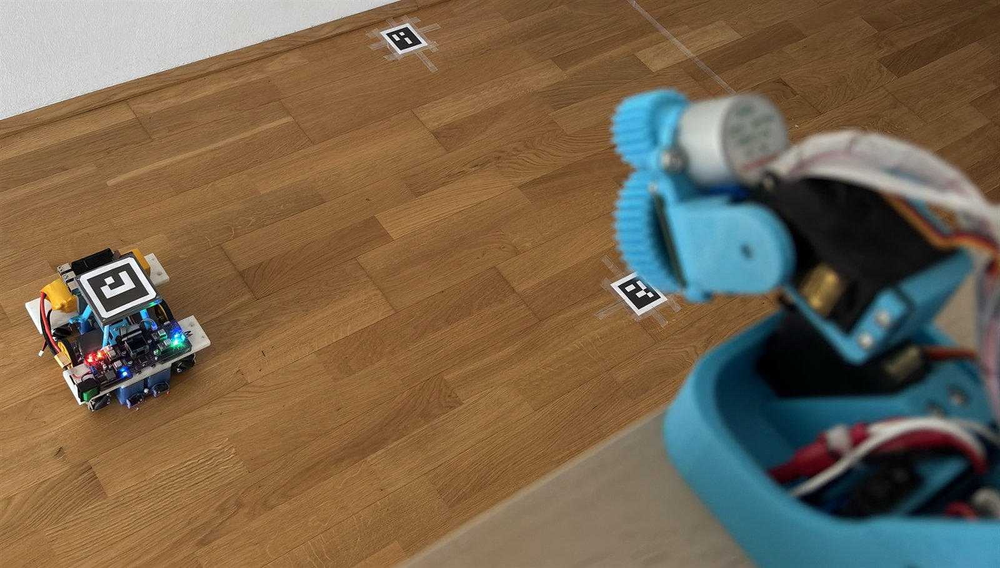

# 06 - Camera / vision integration (`/ws/vision`)



The robot has no proximity sensor of its own: **obstacles from the outside
world enter the system through the `/ws/vision` WebSocket.** A camera,
detector or any other process connects, reports what it currently sees, and
the service treats those reports exactly like obstacles drawn in the console -
with one important extra: a report that arrives **while the robot executes**
is re-checked against the *remaining* route and triggers a stop -> re-route ->
continue only when that route is really affected. The same channel can also
carry the **robot poses** (`poses` message, section 3c) that feed the RPi
sensor fusion (Docs/09).

## 1. Connecting

```
ws://<pi-address>:8080/ws/vision        (docker / nginx)
ws://127.0.0.1:8090/ws/vision           (dev server)
```

No authentication (same as the rest of the console API - the network is the
team hotspot). Multiple clients may connect: the **newest snapshot wins**,
and a report may name its sender with `"client"` (the console sends
`"console"`). One client *owns* the channel at a time; when it disconnects
its obstacles **and its ownership** are dropped immediately, so the console
(which stands down while a real camera streams) can take its mock camera
role back.

On connect the service greets you:

```json
{"type": "hello", "protocol": 1, "peer": "vision:127.0.0.1:53223",
 "ttl_ms": 2000.0,
 "hint": "send {\"type\":\"obstacles\",\"obstacles\":[...],\"ttl_ms\":2000}"}
```

`peer` is your identity on this connection: it is what `vision.source`
(`GET /api/state`) shows while your reports are the active ones - the console
uses it to tell its own reports from a real camera's.

## 2. Sending obstacles

```json
{"type": "obstacles",
 "obstacles": [
   {"kind": "rect",   "x": 1500, "y": 400, "w": 300, "h": 200},
   {"kind": "circle", "x": 900,  "y": 1200, "r": 150}
 ],
 "ttl_ms": 2000,
 "client": "camera",
 "t": 1738073000123.4}
```

* `x`, `y` are the field coordinates **in millimetres** of the rectangle's
  lower-left corner (or the circle centre). `w`/`h`/`r` are mm.
* `client` (optional) names the sender. The console sends `"console"`; a
  real camera/script omits it or uses any other name - the console **yields**
  to such a stream (see section 3b).
* `t` (optional) is the sender's own timestamp in epoch milliseconds. It is
  echoed back in the ack and carried in the console events, so latency and
  the age of a detection can be measured; the service always stamps its own
  receive time (`t_server`) as well. Correlation never needs an id: every
  message gets exactly one reply, in order (TCP).
* The list **replaces** the previous snapshot as a whole - you always send
  what you see *right now*, never diffs.
* `ttl_ms` (default 2000, minimum 100) is the lifetime of the whole snapshot:
  if you stop sending, everything expires after that time (checked every
  0.5 s). Report at least every `ttl_ms` while something is visible; if the
  table is clear you may simply stop sending.
* Coordinates are quantised to 10 mm: sensor jitter below that does not count
  as a change (no re-plan churn), real movement does.
* Aliases `update` and `report` are accepted for `obstacles`.

Answers (same connection):

```json
{"type": "ack", "count": 1, "changed": true, "ttl_ms": 2000.0,
 "t": 1738073000123.4, "t_server": 1738073000147.9}
```

* `changed` tells you whether the service considered this a new obstacle map
  (a refresh of the identical set answers `changed: false` and only extends
  the TTL).
* `count` is the number of active obstacles after this message.
* `t` echoes your timestamp (or `null` if you did not send one); `t_server`
  is when the service received the snapshot (epoch ms). `t_server - t` is the
  end-to-end latency of your pipeline - log it and keep it small.

Other messages:

| You send | You get | Purpose |
|---|---|---|
| `{"type": "clear"}` | `{"type":"ack","count":0,"changed":true}` | drop all camera obstacles now |
| `{"type": "ping"}` | `{"type": "pong"}` | keep-alive / liveness check |
| anything unknown | `{"type":"error","detail":"unknown type ..."}` | protocol help |

## 3. What the service does with them

1. **Every plan** - console requests and the service's own re-plans merge the
   current camera snapshot with the console-drawn obstacles, so a plan made
   after a report always respects it even if the console never saw it.
2. **Console display** - each change is broadcast to the consoles as a
   `vision` event; the obstacles are drawn as **dashed red-orange outlines**
   (visually distinct from the console-drawn solid red ones) and logged as
   `camera: N obstacle(s) - (x, y), ...`.
3. **Dynamic re-plan** - while the robot is executing, a changed snapshot is
   *re-checked*: the remainder of the mission is re-planned in the background
   and compared with the route the robot is on. Reactions are
   **proximity-gated**: only obstacles whose boundary is within
   `half-diagonal + 500 mm` of our robot count - a robot parked on the route
   far ahead changes **nothing** until ours gets close (the proximity watch
   re-checks every 0.5 s as it advances, so no new camera message is needed).
   * **Route unaffected** (obstacle behind the robot, far from the remaining
     route, or only brushing the soft margin): nothing happens; the log says
     `obstacle change does not affect the remaining route - trajectory unchanged`
     (silent when it was only the advancing robot that made the obstacle near).
   * **Route affected** (longer detour needed, or shorter after a removal):
     the robot stops, the remaining mission is re-routed around the new map
     (shortest feasible detour) and the execution continues - a paused run
     stays paused.
   * **Moving obstacle, detour not worth it** (no way around at the physical
     clearance, or the detour is > 1.6x the remaining route / +500 mm): the
     robot **waits** - `moving obstacle blocks the remaining route - waiting
     for it to clear ...`, `GET /api/state` `waiting`, console pill `EXEC
     waiting`. Every following report (and TTL expiry) triggers a resume
     attempt; when the route is free the run restarts by itself from the stop
     point (`the route is clear again - resuming the mission`). A manual
     Plan / Execute / Stop / E-STOP clears the waiting state.
   * Reports arriving in a burst are coalesced: at most one re-plan per 0.25 s.
4. **Expiry** - when a snapshot expires (TTL) the same re-check runs: if the
   obstacle no longer blocks the remaining route, nothing happens (or a
   WAITING run resumes); if it was forcing a detour, the route can be
   optimised back toward the drawing.

## 3b. The console as camera (demo / opponents)

The console can play the camera role for missions: it connects to
`/ws/vision` itself and reports the **opponent robots** (300 x 300 mm
squares) as ordinary vision obstacles. **Default: one robot `R1` at
(2700, 1790) mm.** The count (0-4) and the positions are set in
**Config > Opponent robots** - one X / Y field pair per robot; dragging on
the canvas updates the fields live, *Reset default* returns to 1 robot at
(2700, 1790). Every plan respects them and a running mission re-checks its
remaining route on every move:

* **Drag them anytime on the canvas**, also while our robot is driving. While
  the pointer is held down the console behaves like a **15 Hz camera**: it
  streams the opponent position once per `1000 / 15` ms for the whole drag,
  even when the pointer is still, and stops the stream on release (a final
  report is sent). Outside a drag it sends a keep-alive every 1.5 s with
  `ttl_ms = 180000`, exactly like a camera. The service reacts when the other
  robot gets close to ours (~0.7 m): it re-routes, stops immediately on body
  contact, or parks the run in the *waiting* state until the way clears, then
  continues by itself; a robot left on the path far ahead changes nothing
  until our robot approaches it.
* **A real camera always wins**: the console reports with `"client":
  "console"` and watches the active `source`. When another (non-console)
  client streams, the console **stops reporting** - its robots are dimmed
  ("- paused") and the camera's obstacles are used instead. When that stream
  ends (the disconnect releases the channel) the console resumes by itself.
  Two consoles do not fight: both identify as `"console"`.
* The store **does not keep extra fields** (kind/x/y/w/h only) and quantises
  to 10 mm; the console matches its own reports back by geometry to draw them
  once, as draggable squares with labels.
* If the page is closed the keep-alive stops and the robots expire with their
  TTL - no phantom obstacles are left behind.
* **Box and Zone stay static**: they can only be drawn while the robot
  stands still (the console locks the tools while executing).

## 3c. Robot pose messages (`poses`)

A camera system with ArUco tags on both robots may also report the **robot
poses** on the same connection: this is what feeds the RPi-side sensor
fusion (Docs/09 section 8). Ownership, newest-wins and disconnect rules are
the same as for obstacles; the data is carried at **raw precision**.

```json
{"type": "poses",
 "us":       {"x_mm": 1245.2, "y_mm": 803.4, "theta_deg": 87.5, "conf": 0.90},
 "opponent": {"x_mm": 2450.0, "y_mm": 1210.5, "theta_deg": -95.2, "conf": 0.80},
 "t": 1759680000123.4,
 "ttl_ms": 400,
 "client": "camera"}
```

* `us` / `opponent`: send only the robot(s) currently visible; a missing
  robot means "no fresh measurement now" (never resend stale values).
* `x_mm`, `y_mm`, `theta_deg`: body-centre pose in the FIELD frame, theta CCW
  positive, wrapped to [-180, +180). Millimetre / 0.1 deg precision - poses
  are NOT quantized to 10 mm (that obstacle rule avoids re-plan churn and
  would inject steps into the fusion).
* `conf`: optional 0..1 quality (e.g. from tag pixel size or reprojection
  error); it scales the measurement trust inside the fusion.
* `t`: sender epoch milliseconds; the ack echoes it and reports `t_server`,
  and the service uses `t_server - t` to compensate the pipeline latency.
* `ttl_ms` (default 400, minimum 100): after it the snapshot counts as
  stale - the fusion drops the source silently, nothing needs clearing.
  Recommended rate: 10-30 Hz, fixed period.

Ack:

```json
{"type": "ack", "seen": {"us": true, "opponent": false}, "changed": true,
 "ttl_ms": 400.0, "t": 1759680000123.4, "t_server": 1759680000170.0}
```

What the service does with them: the snapshot is stored for status/UI and
**every** message is pushed into the pose fusion (Docs/09 section 6) -
outlier-gated (Mahalanobis gate, jump confirmation, planar-tag-flip
rejection), latency-compensated and confidence-weighted. `GET /api/state`
exposes the source under `poses` (`fresh`, `seen`, `age_s`, `source`) and
the active pose mode under `loc.mode` (`wheel`, `wheel+gyro`,
`wheel+camera`, `wheel+gyro+camera`). On disconnect the snapshot is released
immediately; a camera that only sends obstacles (or none at all) changes
nothing - the system behaves exactly as before.

## 4. Example client (Python)

```python
import asyncio, json
import websockets  # pip install websockets

async def report():
    async with websockets.connect("ws://127.0.0.1:8090/ws/vision") as ws:
        await ws.recv()  # hello
        while True:
            obstacles = detect()          # your detector: list of dicts
            await ws.send(json.dumps({
                "type": "obstacles",
                "obstacles": obstacles,
                "ttl_ms": 2000,
            }))
            await ws.recv()               # ack
            await asyncio.sleep(0.2)      # >= ttl_ms / 8 keeps it alive

def detect():
    # e.g. one box: {"kind": "rect", "x": 1500, "y": 400, "w": 300, "h": 200}
    return []

asyncio.run(report())
```

A ready test client using the standard library only (`websockets` is the one
dependency) is how the channel was verified:

```bash
# from a PC with the dev server running
python - <<'PY'
import asyncio, json, websockets
async def main():
    async with websockets.connect("ws://127.0.0.1:8090/ws/vision") as ws:
        print(await ws.recv())  # hello
        await ws.send(json.dumps({"type": "obstacles",
            "obstacles": [{"kind": "rect", "x": 1000, "y": 1000, "w": 200, "h": 200}],
            "ttl_ms": 3000}))
        print(await ws.recv())  # ack
asyncio.run(main())
PY
```

## 5. Verifying from the console

* `GET /api/state` contains a `vision` block:
  `{"count": N, "ttl_ms": ..., "source": "vision:<ip>:<port>",
  "obstacles": [...], "t": <camera clock or null>, "t_server": <receive time>}`.
* The console log shows `vision: N obstacle(s) - (x, y)` on every effective
  change and `vision re-plan: the remaining mission was updated ...` when a
  running mission was re-routed.
* In MOCK mode you can test the whole loop without the real robot: start a
  mission, then send an obstacle onto its remaining route and watch the robot
  stop, detour and finish.

## 6. Practical guidance

* Keep `ttl_ms` small (1-3 s) so a crashed detector cannot leave phantom
  obstacles; the sweep drops them automatically.
* Send a `clear` on shutdown if you want the table cleared instantly
  (disconnect already does this).
* The obstacle you report should be the **physical object** (not inflated);
  the service adds the robot clearance itself.
* If you detect many small blobs, merging them into a few rectangles reduces
  plan-detail churn; up to 64 obstacles per snapshot are accepted.
