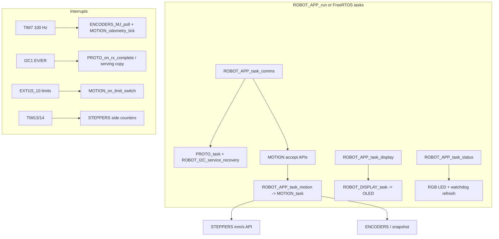
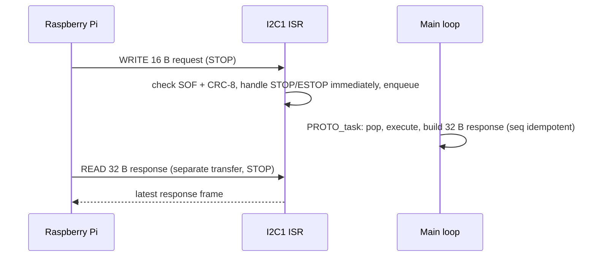

# 02 - Firmware architecture

*Author: Mouadh Jeridi - jeridimouadh@gmail.com*

## 1. Module map

| Layer | Files | Responsibility |
|---|---|---|
| Entry point | `Core/Src/main.c` | Only `main()`: application init + scheduler call |
| Application | `App/Src/robot_app.c` , `App/Inc/robot_app.h` | Init sequence, task step functions, scheduler, HAL timer/EXTI callbacks, error handler |
| Board support | `App/Src/robot_board.c` , `App/Inc/robot_board.h` | MPU, clock, all peripheral bring-up (`BSP_*`), handle ownership, watchdog |
| Port layer | `App/Src/robot_port_baremetal.c` , `App/Inc/robot_port.h` | Critical sections, tick, delay, idle wait (single file to swap for FreeRTOS) |
| I2C manager | `App/Src/robot_i2c.c` , `App/Inc/robot_i2c.h` | Slave listen mode, OLED master windows, bus recovery, HAL I2C callbacks |
| Display | `App/Src/robot_display.c` , `App/Inc/robot_display.h` | OLED manager: Charara logo home screen, temporary RPi messages (hold window), persistent manual mode |
| Status | `App/Src/robot_status.c` , `App/Inc/robot_status.h` | RGB LED indication (colour code: Docs/08) and button events |
| Motion engine | `Core/Src/motion.c` , `Core/Inc/motion.h` | Odometry, ramped closed-loop DRIVE/TURN/ARC/GOTO/STRAFE, faults, limit switches, deadman, gyro-aided control heading (fw 3.3, silent SET_GYRO stream), velocity stream mode (fw 3.4, silent SET_VELOCITY stream), idle-only RELEASE_MOTORS (fw 3.5) |
| Settings store | `App/Src/robot_settings.c` , `App/Inc/robot_settings.h` | Calibrated robot parameters (17-register map): validation, application to the drivers, append-only flash persistence |
| Event log | `App/Src/robot_events.c` , `App/Inc/robot_events.h` | Error/event ring (code + context, monotonic index) and boot-cause capture; readable over `QUERY_EVENTS` |
| Protocol | `Core/Src/robot_protocol.c` , `Core/Inc/robot_protocol.h` | 16 B request / 32 B response frames, CRC-8, request ring, command execution, config/event commands, display text |
| Stepper driver | `Drivers/STEPPERS_MouadhJeridi/*` | mm/s -> ARR conversion, per-side groups, direction/enable control, runtime direction inversion, open-loop fallback counters |
| Encoder driver | `Drivers/ENCODERS_MouadhJeridi/*` | 100 Hz polling of TIM5/TIM8 counters, wrap-safe accumulation, velocity EMA, runtime counting-direction inversion |
| OLED driver | `Drivers/OLED_MouadhJeridi/*` | SSD1306 over I2C with finite timeouts and a sticky error flag |
| Config | `App/Inc/robot_configs.h` | **Compile-time defaults** for geometry, limits, gains, protocol and flash layout - the live values come from the settings store |

**Layering rule:** `Drivers/` holds project-independent drivers only - the
wheel mechanics are passed at runtime through `STEPPERS_MJ_configure()` and
`ENCODERS_MJ_configure()`; every robot-specific value lives in `App/`.

### Settings store (calibrated configuration)

The live robot parameters are a packed image of 17 u16 registers (stepper
wheel geometry, drive track/wheelbase, odometry wheel/ticks/track, motion
limits, control gains, strafe pattern and direction-inversion masks; full
table in `Docs/03` section 6). They are kept in RAM and persisted in the
**last flash sector** (`0x08060000..0x0807FFFF`, reserved by
`EWARM/stm32f722xx_flash.icf`):

* boot: compile-time defaults -> newest valid flash record (magic + map
  version + FNV-1a hash + per-register range check) ->
  `ROBOT_SETTINGS_apply()` hands the wheel mechanics to the stepper/encoder
drivers, applies the direction inversions and refreshes the motion limits;
* runtime: `GET/SET/SAVE/LOAD/RESET_CONFIG` edit the image; writes are
  idle-guarded and all-or-nothing (unknown/read-only/out-of-range values
  reject the whole frame);
* `SAVE_CONFIG` appends one 64-byte record; the sector is erased only when
  it is full, so a save never holds the flash long enough to disturb the
  watchdog;
* an invalid record falls back to the defaults and records
  `CONFIG_FALLBACK` (reason in the context byte) / `FLASH_ERROR` events.

## 2. Layering



## 3. Interrupts and priorities (NVIC group 4)

| IRQ | Priority | Handler work | Frequency |
|---|---|---|---|
| EXTI15_10 (limits) | 0 (highest) | stop pulses + drivers off, record switch, flag the fault for the task | rare |
| I2C1_EV / I2C1_ER | 1 | slave frame RX/TX, validate + enqueue, safety flags | per transaction |
| TIM7 | 2 | encoder poll, odometry integration (float math) | 100 Hz |
| TIM8_UP_TIM13 / TIM8_TRG_COM_TIM14 | 3 | side counters (open-loop fallback; interrupt armed only while the driver target API is used) | on demand |
| EXTI9_5 (buttons) | 5 | LED toggles | rare |
| TIM6_DAC (HAL tick) | 15 | `HAL_IncTick` | 1 kHz |

No interrupts are enabled on the step timers themselves, and the encoder
timers run **without** capture/compare interrupts, encoder counters are
polled at 100 Hz.

## 4. Request lifecycle (I2C)



* Frames are **fixed size** (16 B in, 32 B out). Any other write/read length
  makes the HAL slave driver report an error; the firmware recovers
  automatically (see section 6) but the transaction must be retried.
* **Write and read are two separate I2C transactions** (write .. STOP, then
  read .. STOP). Repeated-START sequences (write+read in one session) are not
  supported by this slave design.
* Sequence number = idempotency key: retry a lost transaction **with the same
  seq**; the STM32 remembers the last four executed sequence numbers, so a
  retry can never execute a command twice.

## 5. Scheduling

```c
/* ROBOT_APP_run() - bare-metal super loop; every step is an independent task
   entry point for an RTOS (see "RTOS porting" below). */
for (;;) {
    ROBOT_APP_task_comms();    // protocol ring + I2C recovery (single writer)
    ROBOT_APP_task_motion();   // segment control (microseconds of work)
    ROBOT_APP_task_display();  // OLED redraw on content change (bus-quiet)
    ROBOT_APP_task_status();   // RGB LED + IWDG refresh
    ROBOT_PORT_idle();         // WFI (bare metal) / taskYIELD (RTOS port)
}
```

Nothing in the task steps blocks longer than one I2C transfer.
Command latency is bounded by the loop period (us) plus the I2C transfer
time (~5 ms).

## 6. Error handling and recovery

| Failure | Detection | Recovery |
|---|---|---|
| I2C bus error (NACK, arbitration, BERR) | `HAL_I2C_ErrorCallback` sets a flag | comms task `ROBOT_I2C_service_recovery`: DeInit + Init + listen; retried every pass until success |
| Slaves stops answering | `ROBOT_i2c_arm_listen` fails | recovery flag, as above |
| OLED absent/stuck | 50 ms timeouts + sticky error flag in the driver | redraws skipped/bail-out; 10 s back-off (`ROBOT_OLED_BACKOFF_MS`) |
| Motion stall | no encoder progress for 350 ms while stepping | fault `STALL`, motors stopped + drivers disabled |
| Segment timeout | deadline = 2.2*nominal + 3 s | fault `TIMEOUT` |
| Wall limit switch | EXTI ISR | stop + drivers off at interrupt latency; `LIMIT` latched by the motion task in the same control cycle |
| E-STOP command | I2C ISR (validated CRC) | immediate stop + fault `ESTOP` (latched) |
| RPi heartbeat lost (deadman enabled) | no valid frame within timeout during motion | fault `DEADMAN`, controlled stop |
| Settings record invalid | magic/map/hash/range check while loading | compile-time defaults + `CONFIG_FALLBACK` event (reason in the context byte) |
| Flash save failure | HAL flash status + read-back verification | `STORAGE` response + `FLASH_ERROR` event (erase/program/verify) |
| Firmware stuck | IWDG (~500 ms) | MCU reset; `Error_Handler` also puts motors in safe state |

`CLEAR_FAULTS` (0x03) clears the latched faults; drivers stay disabled until
the next accepted motion command.

**Every failure is reported.** The board records an event for every fault,
rejected frame (bad CRC/length, unknown command, bad parameter, busy) and
config/flash operation, plus the boot cause (watchdog, power-on, software
reset). Each event carries a code, a context byte and a monotonic index
(codes in `Docs/03` section 6). `QUERY_STATUS` carries the last event and
the boot cause; `QUERY_EVENTS` drains the ring. The RPi service decodes the
codes into readable log lines and lists them in the console Calibration tab.

## 7. MISRA C:2012 orientation

Application modules (`motion.c`, `robot_protocol.c`, the `App/` layer and the
driver code) follow MISRA-C:2012 guidance:

* no dynamic memory, no recursion, bounded loops (`for` with fixed limits,
  `do/while` with magnitude guard), single-purpose small functions;
* every `switch` has a `default`; every `if/else` chain is terminated;
* explicit casts at all implicit-conversion points; `float` literals suffixed;
* all objects initialized before use; file-scope state is `static`;
* ISR-shared flags are `volatile`; multi-writer state is protected with short
  `__disable_irq()/__enable_irq()` critical sections or single-writer rules
  (the limit-switch ISR performs hardware actions only - all engine state is
  written by `MOTION_task()`);
* fixed-width types from `<stdint.h>` everywhere.

Deviations (documented): the ST HAL / CMSIS / SSD1306 vendor code is outside
the scope; `while (1)` hardware loops in `Error_Handler` context; the
`UNUSED()` macro is used for HAL callback parameters.

### Documentation conventions

Every function is documented with a Doxygen brief at its declaration (public
API in headers) or at its definition (static helpers). Constants live only in the
project configuration (`App/Inc/robot_configs.h`). Code base and documentation maintained by
Mouadh Jeridi (jeridimouadh@gmail.com).

## 8. Timing budget (216 MHz core)

| Activity | Cost | Margin |
|---|---|---|
| Odometry ISR (100 Hz) | ~2 us float math | trivial |
| Side counter ISRs | not armed in closed-loop operation (driver open-loop API only) | 0 % by default |
| Protocol RX ISR | ~20 us per frame (CRC over 16 B) | fine |
| OLED redraw (content change only) | ~100 ms bus time at 100 kHz, rare | bus occupancy ~ 0 % |
| Motion task | ~us, runs at loop rate (>>1 kHz) | excellent |

No dead-interrupt load and no blocking waits, so there is headroom for future features
(e.g. a higher odometry rate).

## 9. RTOS porting (FreeRTOS)

The application is already split into four independent task steps, so a
FreeRTOS migration touches only the port layer and the task creation:

1. Implement `App/Src/robot_port_freertos.c` (replace
   `robot_port_baremetal.c` in the build):

```c
#include "robot_port.h"
#include "FreeRTOS.h"
#include "task.h"

void ROBOT_PORT_critical_enter(void) { taskENTER_CRITICAL(); }
void ROBOT_PORT_critical_exit(void)  { taskEXIT_CRITICAL();  }
uint32_t ROBOT_PORT_tick_ms(void)    { return (uint32_t)xTaskGetTickCount(); }
void ROBOT_PORT_delay_ms(uint32_t d) { vTaskDelay(pdMS_TO_TICKS(d)); }
void ROBOT_PORT_idle(void)           { taskYIELD(); }
```

2. Create the tasks in `main()` after `ROBOT_APP_init()` (or from a startup
   task that then deletes itself):

```c
xTaskCreate((TaskFunction_t)comms_task,   "comms",   512, NULL, 4, NULL);
xTaskCreate((TaskFunction_t)motion_task,  "motion",  512, NULL, 3, NULL);
xTaskCreate((TaskFunction_t)status_task,  "status",  256, NULL, 2, NULL);
xTaskCreate((TaskFunction_t)display_task, "display", 1024, NULL, 1, NULL);
vTaskStartScheduler();
```

   with e.g. `static void comms_task(void *p) { (void)p; for (;;) {
   ROBOT_APP_task_comms(); vTaskDelay(1); } }` (motion: 1 ms period or
   shorter; status: 50-100 ms; display: 50 ms - it redraws only when the
   screen content changes).

3. ISRs stay unchanged: no FreeRTOS API is called from any interrupt in
   this design (all ISR code only sets flags / moves data), so no `FromISR`
   wrappers are required.
4. HAL time base: keep TIM6 at priority 15, or take the HAL tick from the
   FreeRTOS tick. If the FreeRTOS-aware HAL mode is enabled, keep
   `HAL_InitTick` priority numerically >= `configMAX_SYSCALL_INTERRUPT_PRIORITY`.
5. The critical sections in the code (`ROBOT_PORT_critical_*`) are entered
   from task context only, so the `taskENTER_CRITICAL` mapping is legal.
6. The status task must keep running: it is the IWDG feeder. Give it a
   period well below the watchdog timeout (~500 ms).

Priority order recommendation: comms > motion > status > display.

## 10. CubeMX regeneration workflow

`main.c` is intentionally minimal and the generated init code now lives in
`App/Src/robot_board.c` under `BSP_*` names. When the .ioc is re-generated:

1. Keep the minimal `main()` (template in
   `Docs/reference/main_cubemx_reference.txt` is the historical source).
2. Copy the regenerated bodies of the clock / MPU / peripheral init functions
   into the matching `BSP_*` functions (same order as `BSP_init`).
3. Keep the `USER CODE` sections of `stm32f7xx_it.c` (the `EXTI15_10`
   handler and the timer handlers are required).
4. Never add application logic back to `main.c` - it belongs to the App layer.
