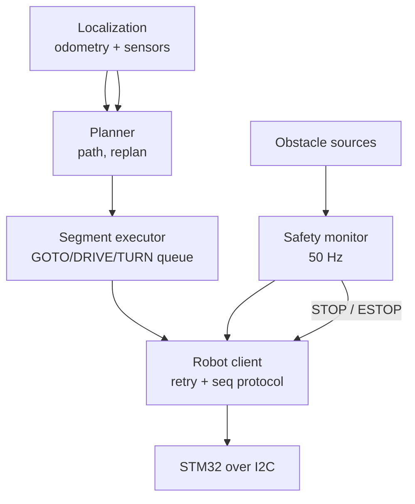

# 05 - Raspberry Pi integration & navigation design guide

*Author: Mouadh Jeridi - jeridimouadh@gmail.com*

This guide is for the developer working on the Raspberry Pi software. It
describes the architecture the shipped implementation follows, the exact
interaction patterns with the STM32 board, and the safety rules. Protocol
mechanics are in `Docs/03-i2c-protocol-spec.md`; motion behaviour is in
`Docs/04`.

The implementation lives in the `charara` repository (`charara/charara`):
`software/core` (planning, localization, mission engine), `software/robot`
(this client), `software/console` (calibration/test/plan service) and
`software/brain` (plays a saved strategy headless). It follows this guide:
one motion command in flight (the executor), retries reuse the `seq` and
verify the echoed one, the deadman is armed during execution, odometry is
fed to the estimator at 10 Hz. That side's documentation:
`charara/charara/Docs/index.md`.

## 1. What the STM32 does and does not do

| STM32 does | Raspberry Pi does |
|---|---|
| Execute segments (DRIVE/TURN/ARC/GOTO/STRAFE) with closed-loop control | Global localization & map |
| Report odometry (x, y, theta, wheel speeds) and status | Path planning (grid/graph/trajectory) |
| Enforce ramps, tolerances, stall/timeout supervision | Obstacle detection & avoidance decisions |
| Hard safety: limit switches, E-STOP, deadman, watchdog | Sensor processing (lidar/camera/ultrasonic) |
| Show the logo home screen & RPi messages (`DISPLAY_TEXT`) | High-level mission logic, teleop, UI |

Design rule: **the Pi never streams wheel speeds.** It submits short,
atomic segments (waypoints, or line/arc/turn pieces) and supervises them.

## 2. Recommended Pi architecture



* **Robot client** - one thread only talks to I2C; serializes transactions,
  implements the retry loop and `wait_idle`.
* **Segment executor** - keeps exactly **one motion command in flight**;
  submits the next one when state returns to IDLE. Tangent arc chains can
  be pipelined with `QUEUE_ARC` (0x17): the board blends the queued arc
  into the running one (no stop - one acceleration, one deceleration).
* **Safety monitor** - watches obstacles, deadman, faults; can inject `STOP`
  (replan) or `ESTOP` (emergency) at any time; re-enables via `CLEAR_FAULTS`.
* **Localization** - fuses the board odometry with absolute sensors
  (landmarks, laser); on jump/reset calls `SET_POSE`.

Suggested rates: odometry poll 20-50 Hz (the shipped service uses 10 Hz),
safety monitor on the 0.5 s proximity watchdog plus per-segment polling,
planner on demand, deadman enabled at 500-1500 ms (any valid request
refreshes it; the shipped default is 1500 ms, with stall/timeout
supervision on the board side).

## 3. Segment submission patterns

| Situation | Recommended command |
|---|---|
| Waypoint with final heading | `GOTO(x, y, theta, v)` |
| Smooth curved path (no in-place turns) | `ARC(radius, sweep, v)` between `DRIVE` legs - line-arc-line chains |
| Straight approach/dock | `TURN` to bearing, then `DRIVE` |
| Fine heading trim before docking | `TURN` small angle, low speed |
| Lateral docking (short only!) | `STRAFE` then `SET_POSE` after re-localization |
| Unknown distance until sensor contact | short `DRIVE` chunks (50-150 mm) and re-check sensor between chunks |
| Stop to replan (non-emergency) | `STOP` - odometry and holding torque preserved |
| Release drivers while parked | `RELEASE_MOTORS` (fw >= 3.5) - idle only, no fault latch; next move re-energizes |
| Emergency | `ESTOP` - instant stop + drivers off; needs `CLEAR_FAULTS` |

Serialization rule: motion commands return `BUSY` while a segment runs.
`RELEASE_MOTORS` follows the same rule and is refused with `BUSY` while the
robot moves; wait for `state == IDLE` before sending it.
Poll `QUERY_STATUS` (or odometry) until `state == IDLE`, then submit the
next segment. Never queue motion commands blindly - the ONE exception is
`QUEUE_ARC` (0x17), designed for exactly this: it stores one arc and
starts it without stopping when the running segment completes.

### 3.1 Smooth paths with arcs (line-arc-line)

`DRIVE`, `TURN`, `ARC` and `GOTO` all start from the current pose, so they
compose into tangent-continuous chains without any in-place turn:

```python
r.drive(400, 120);    r.wait_idle()   # leg 1, heading 0
r.arc(300, +90, 120); r.wait_idle()   # quarter circle to the left
r.drive(400, 120);    r.wait_idle()   # leg 2, now heading +90 deg
```

* Left arc: `radius > 0, sweep > 0`; right arc: both negative. The end
  heading is `start_heading + sweep`; the next straight leg lies on that
  heading.
* Completion tolerances are 0.5 mm (arc) and 0.8 deg (sweep); errors are
  corrected at every segment, so chains do not accumulate drift.
* Each junction has a short creep-speed stop unless the next arc is queued
  with `QUEUE_ARC` (0x17) while the previous one runs: the board then
  blends the chain without stopping (poll at 50 Hz to keep any remaining
  junction pause minimal).
* Below ~100 mm radius the inner wheel runs very slowly or in reverse
  (allowed); the firmware caps the speed automatically so the outer wheel
  stays within the configured limits.
* Forward arcs only. For reverse manoeuvres use short `STRAFE` moves (no
  lateral odometry) or an in-place `TURN`.

## 4. Obstacle handling workflow

**Dynamic obstacle (moving person/car):**
1. Safety monitor sees the obstacle inside the safety envelope -> `STOP`.
2. Wait until the corridor is clear (sensor-based), then re-issue the same
   segment (or a shorter version) - no re-planning needed.
3. If blocked more than N seconds -> treat as static.

**Static obstacle:**
1. `STOP`.
2. Localization confirms pose (odometry + landmarks).
3. Planner produces a new path around the obstacle.
4. Execute the new path as GOTO waypoints.
5. If the segment is short/irregular, split into DRIVE/TURN pairs.

**Wall contact (limit switch):**
1. Status shows `faults & 0x0002 == LIMIT`, `limits` byte tells which switch.
2. `CLEAR_FAULTS`.
3. Drive away from the wall (`DRIVE` negative of the last approach).
4. Re-localize against the wall constraint, then re-plan.

## 5. Deadman design

Enable it (`SET_DEADMAN(ms)`) whenever the robot can move autonomously:

```python
robot.transact(0x15, (750).to_bytes(2, "little"))   # 750 ms
```

The Pi must then produce at least one *valid* request (any command, e.g.
`QUERY_ODOMETRY`/`PING`) within each window while a segment is running.
A stuck navigation loop thus stops the robot automatically. Keep the polling
period <= timeout/3.

## 6. Reference navigation loop (pseudocode)

```python
r = Robot()
assert r.status() and r.status()["fw"] == "3.0"
r.clear_faults()
r.transact(0x15, (750).to_bytes(2, "little"))        # deadman on

def follow(path_points, cruise=120.0):
    for (x, y, th) in path_points:
        while True:
            state = r.status()
            if state is None:                       # bus trouble
                r.stop(); continue
            if state["state"] in (5, 6):            # FAULT/ESTOP
                raise RuntimeError(f"robot fault {state['faults']:#x}")
            if obstacle_too_close():
                r.stop()
                if not wait_for_clear(2.0):
                    return "REPLAN"
                continue
            if state["state"] == 0:                 # IDLE -> next segment
                status, _ = r.goto(x, y, th, cruise)
                if status == 4:                     # BUSY: previous still running
                    continue
                if status not in (0,):
                    return f"REJECTED {status}"
                break
    return "DONE"

while mission:
    result = follow(plan())
    if result == "REPLAN":
        plan = replan()
    elif result.startswith("REJECTED"):
        handle_error(...)
```

## 7. Startup and re-localization procedure

1. Power on; wait ~1 s for boot; `PING` until answered.
2. `QUERY_STATUS` -> expect `3.0`, IDLE, no faults; note `reset_cause`
   (a `RESET_WATCHDOG` after a normal run is worth investigating) and
   `cfg_dirty` (1 = the calibration was edited but not saved).
3. Confirm the calibrated settings are the expected ones: `GET_CONFIG`
   (registers 0..16, two frames) or trust the saved values and just check
   `cfg_map_version`.
4. Place robot on a known reference (wall/dock) -> `SET_POSE(x, y, theta)`.
5. Verify with `QUERY_ODOMETRY` (values within tolerance of the reference).
6. Enable deadman, then run the mission.

Re-localization triggers: after `STRAFE`, after limit contact, after any
`SET_POSE`, after the odometry shows a jump inconsistent with wheel speeds,
or whenever the absolute sensor disagrees by more than its tolerance.

## 8. Error-handling runbook (Pi side)

| Event | Handling |
|---|---|
| I2C timeout / NACK | retry same seq up to 8 times, then pause 50 ms and retry; alert after ~1 s of failures |
| `BAD_CRC` / `BAD_FRAME` response | retry same seq (framing glitch) |
| `BAD_LEN` | payload shorter than the command requires - fix the frame (check the length bytes) |
| `STORAGE` (SAVE_CONFIG) | flash operation failed; read `QUERY_EVENTS` for the `FLASH_ERROR` reason and retry once |
| `BUSY` | wait 10-20 ms, re-poll status (do not spam commands) |
| `RANGE` | programming error - fix payload scale (mm vs 0.1 mm!) |
| `FAULT` | read faults; LIMIT -> wall procedure; STALL -> try backing off slowly; TIMEOUT -> re-plan |
| Unexplained rejection / odd behaviour | drain `QUERY_EVENTS` (codes in Docs/03 section 6): the log names the command and the reason, including failed frames and config fallbacks |
| Repeated ESTOP faults | check safety monitor logic; keep deadman short |
| Board not answering after power glitch | wait for IWDG reset (~0.5 s) and re-`PING` |

## 9. Do / Don't cheat sheet

* **Do** use `GOTO` for waypoints and `TURN`+`DRIVE` for precision work.
* **Do** keep segments short (<= 1-2 m) so failures stay localized.
* **Do** poll status/odometry at 20-50 Hz and keep the deadman fed.
* **Do** treat every transaction as unreliable (retry, same seq).
* **Do** read `QUERY_EVENTS` after every anomaly - it says what failed.
* **Don't** assume strafe is measurable - re-localize after using it.
* **Don't** send a new motion command before the previous one reports IDLE.
* **Don't** disable the deadman while driving autonomously.
* **Don't** forget units: protocol positions are 0.1 mm / 0.1 deg, speeds are
  u16 mm/s (ceiling 900), odometry replies are um / mdeg.
* **Don't** write settings (SET_CONFIG) while the robot moves - the board
  refuses with BUSY, by design.
