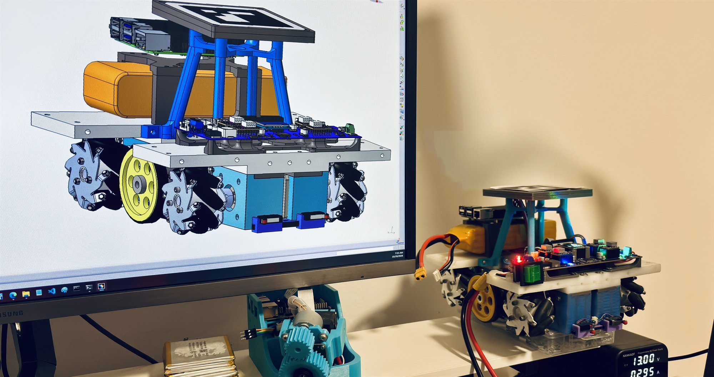

# Charara - Documentation



This folder documents the **robot software** (`software/`: console service +
brain runtime) and the **web console** of the Charara robot. It is
written so that a person or an AI agent can pick up the project and work on it
without hidden knowledge.

| # | Document | What you learn |
|---|---|---|
| [01](01-system-overview.md) | System overview | The whole machine: STM32 board, Raspberry Pi software (console + brain), camera; data flow; coordinate frames; mock vs real |
| [02](02-backend-architecture.md) | Software architecture | Repository layout, package layering, the core domain, ports, console service, brain runtime, deployment |
| [03](03-planner-algorithms.md) | Planner & algorithms | Line/arc fitting, occupancy grid, Theta\* routing, corner fillets, resampling, native arc emission, velocity profile, dynamic re-planning - with formulas |
| [04](04-console-guide.md) | Console user guide | Every tool, tab and button, the mission workflow, warnings explained, troubleshooting |
| [05](05-api-reference.md) | API reference | Every REST endpoint and WebSocket channel with schemas, examples and error codes |
| [06](06-vision-camera-integration.md) | Camera / vision integration | How the camera reports obstacles over `/ws/vision`, TTL semantics, example client, behaviour |
| [07](07-development-guide.md) | Development guide | Dev setup, tests, conventions, how-tos, gotchas, glossary |
| [08](08-brain-and-strategies.md) | Brain & strategies | Strategy document format, save/load, the headless player, running it with docker |
| [09](09-sensor-fusion-and-control-architecture.md) | Sensor fusion & control architecture | The MPU6050 + ArUco camera-pose fusion, control layers, the camera interface contract, degraded modes (no IMU / no camera / mock), implementation status and feature gates |
| [10](10-roadmap.md) | Implementation roadmap | The agreed next tracks - continuity tuning (A), streaming pursuit / Pure Pursuit-RAMSETE (B), behavior-tree match layer (C) - with designs, tests, acceptance criteria and the off-robot / on-robot split |

Related documents outside this folder:

* `../README.md` - the RPI component readme (quick start, docker, feature list)

The STM32 firmware and its documentation set (including the I2C wire protocol
spec) live in the firmware project, not in this repository; the Python codec
mirroring the wire protocol is `software/robot/protocol.py`.

## The 60-second summary

```
camera --/ws/vision--> +-------------------------------+
console --REST /api--> |  RPI service (FastAPI)        | <--I2C--> STM32 board
console <--/ws-------- |  planner -> executor -> client  |          (motors, encoders,
                       +------------------------------+           limit switches, OLED)
```

* The **console** (browser) draws the field, the mission and the obstacles, and
  shows telemetry/logs. It never talks to the board directly.
* The **RPI software** (`software/`) is ONE package: the console service and
  the brain compose the same core. It plans paths (drawn-first routing,
  fillet smoothing, native arcs), executes them segment by segment
  (`GOTO`/`ARC`/`TURN`/`PAUSE`), supervises faults and broadcasts everything
  over WebSockets (console) - the brain does the same headless.
* The **brain** plays a SAVED strategy: plan from the live pose, execute,
  avoid obstacles, repeat - the robot's main job in a match.
* The **camera** (or any vision detector) pushes obstacle snapshots over a
  dedicated WebSocket; the software merges them into every plan and re-routes a
  running mission only when its *remaining* route is actually affected.
* The **board** executes one absolute move at a time over I2C (protocol v3:
  motion commands, settings registers, board event log).
