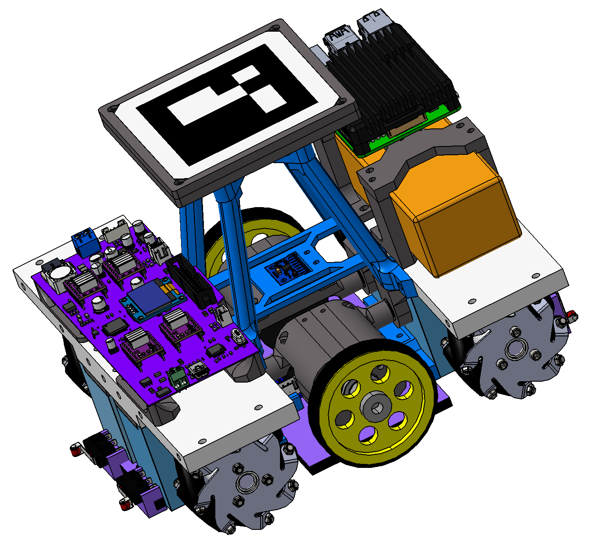
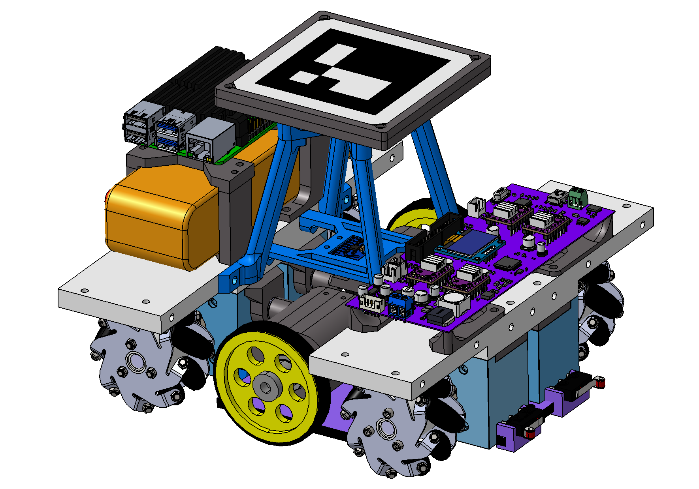
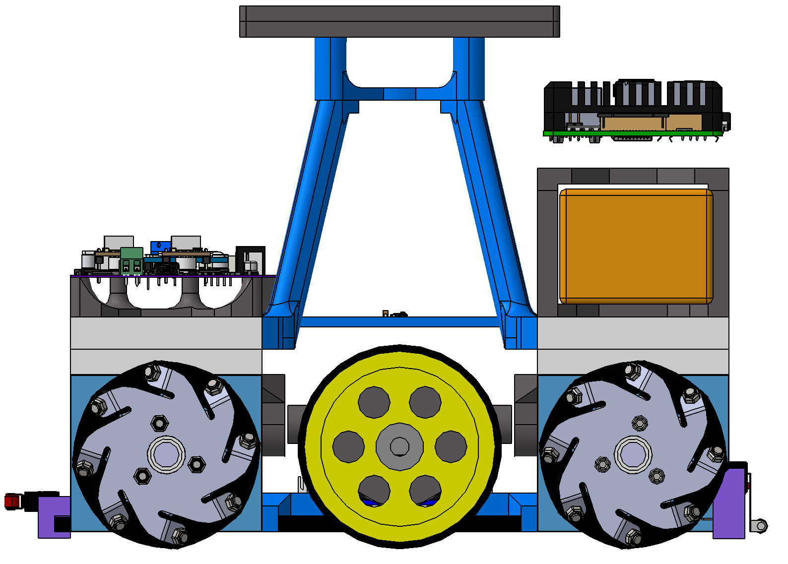
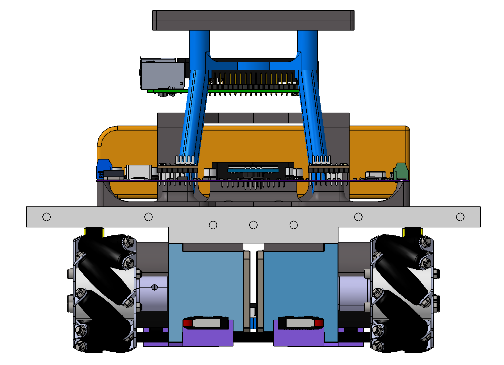
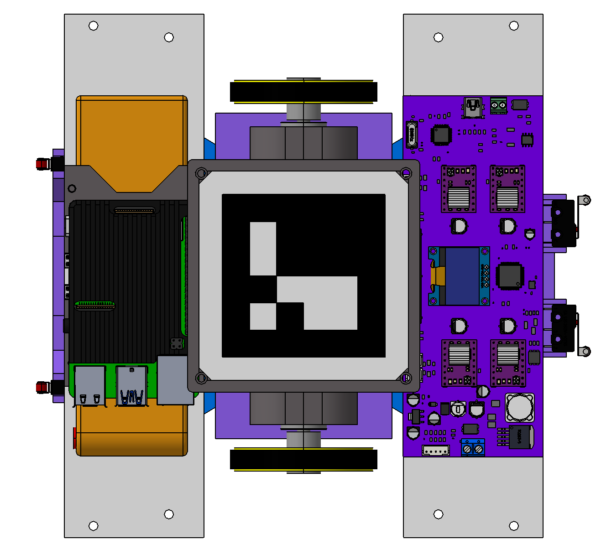
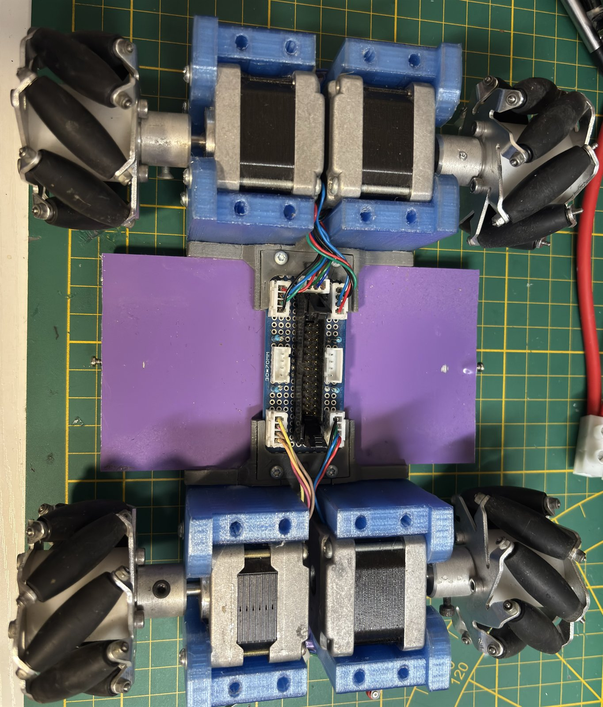
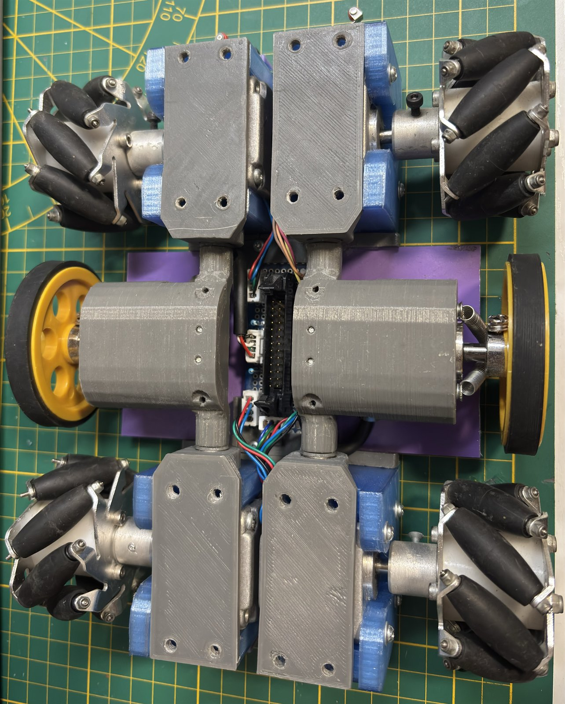
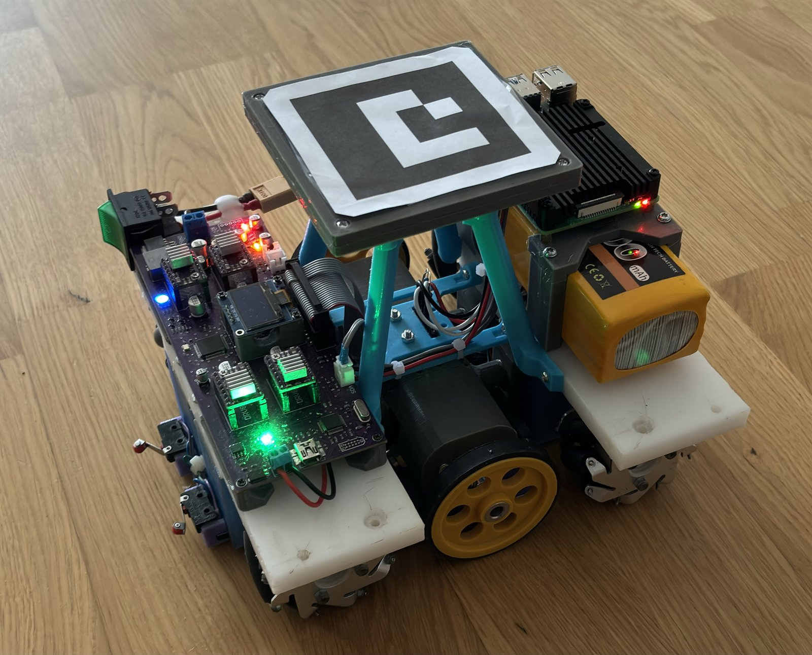
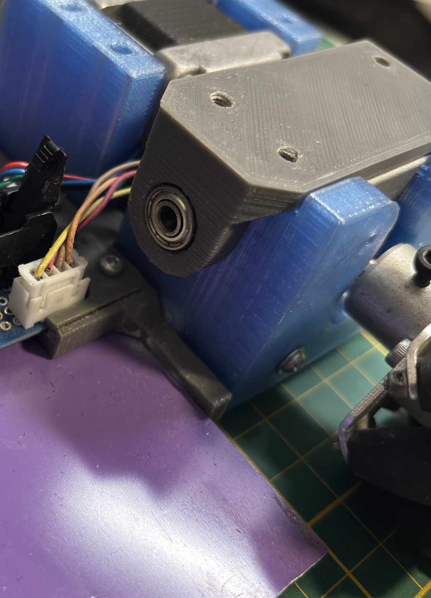
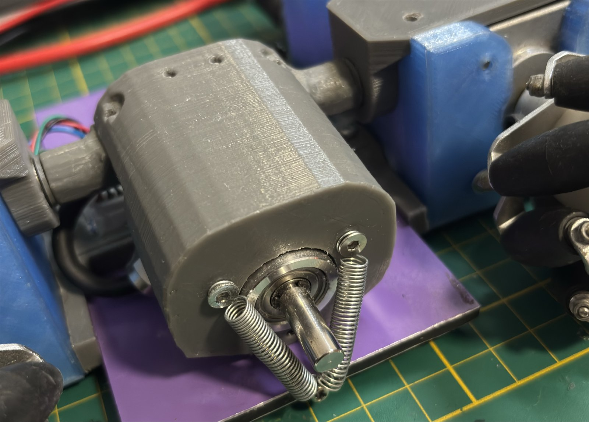

# Mechanical

Charara is a four-wheel **mecanum** platform: each drive module carries a
mecanum wheel through a printed gearbox on a stepper, and the frame mixes
3D-printed structural parts with aluminium plates.

Two sets of images:

- `CAD_photos/` - views exported from the CAD (the design).
- [`../Docs/assets/hardware/`](../Docs/assets/hardware/) - photographs of the
  robot as built (the result). The raw camera files stay out of git.

The geometry the software cares about - body size, clearance margin,
half-diagonal - is configured in the console, see
[`../Docs/04-console-guide.md`](../Docs/04-console-guide.md) section 8.

## CAD

  
  

<b>Isometric, electronics side</b> &nbsp;·&nbsp; <b>isometric, drivetrain side</b>

  
  
  

<b>Front</b> &nbsp;·&nbsp; <b>side</b> &nbsp;·&nbsp; <b>top</b>

## Real photos

  
  
  

<b>Bare chassis</b> &nbsp;·&nbsp; <b>drivetrain, wired</b> &nbsp;·&nbsp; <b>assembled robot</b>

  
  
  

<b>Wheel hub</b> &nbsp;·&nbsp; <b>stepper coupling</b> &nbsp;·&nbsp; <b>robot and camera on the field</b>
