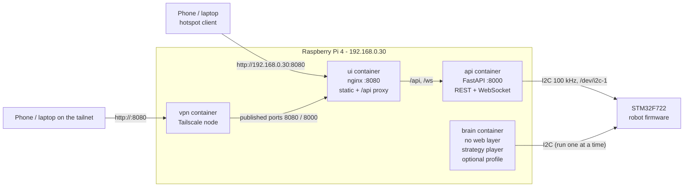
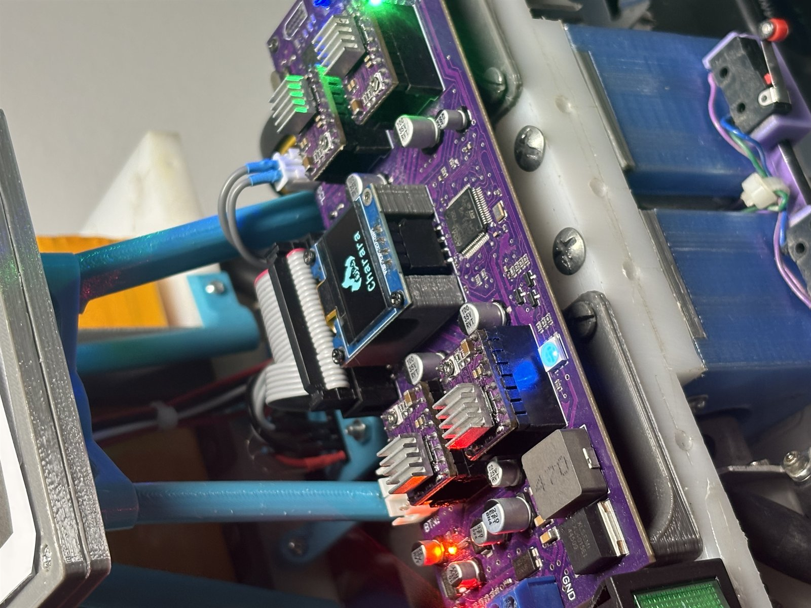

# Charara - robot software (console, planner, brain)

[](https://github.com/jmouadh/charara/actions/workflows/ci.yml)
[](https://jmouadh.github.io/charara/)
[](LICENSE)


[](Docs/assets/charara-robot.jpg)

<sub><b>Designed, built, programmed.</b> CAD model (left) and the robot as built
(right): four mecanum wheels on steppers, the STM32F722 driver board, the
Raspberry Pi 4, the power stack - and, in the foreground, a printed drive
gearbox.</sub>

*Author: Mouadh Jeridi - jeridimouadh@gmail.com*

**Documentation site:** <https://jmouadh.github.io/charara/>

Software for the Raspberry Pi next to the Eurobot table, one Python package
(`software/`) with two applications:

* **console** - a web UI + FastAPI service to configure, calibrate, test and
  plan: place the robot, draw paths on the field, plan them (grid A*/Theta* +
  smoothing, native arcs), execute them on the STM32 board over I2C protocol
  v3 (wire protocol mirrored in `software/robot/protocol.py`), and save
  **strategies**. Reach it on the hotspot (`http://192.168.0.30:8080`) or from
  anywhere over
  **Tailscale** (the `vpn` container: `http://<tailnet-name>:8080`).
* **brain** - the RPi's main job: play a saved strategy headless (plan ->
  execute -> avoid obstacles -> repeat), no browser needed
  (`python -m software.brain --strategy <name>`).

> **Full documentation:** [`Docs/index.md`](Docs/index.md) - system
> overview, software architecture, planner & algorithms, console guide, API
> reference, camera/vision integration, development guide and
> [brain & strategies](Docs/08-brain-and-strategies.md).



## Hardware

The electronics are designed in-house: one board carrying the STM32F722, four
stepper drivers with heatsinks, the power stage and the I2C / encoder
connectors, with a small OLED for the robot status. The frame mixes
3D-printed structural parts with aluminium plates, and the drive modules carry
the mecanum wheels.

[](Docs/assets/hardware-electronics.jpg)

<sub><b>The controller board as assembled:</b> STM32F722, four stepper drivers
under heatsinks, the power stage and the status OLED showing the Charara
logo.</sub>

Sources: [`Electrical/`](Electrical/) (schematic, PCB routing) and
[`Mecanical/`](Mecanical/) (CAD captures).

## The console in pictures

A live session against the real STM32 board (`SW 3.2.0`, `FW 3.5`): the mission
panel, a path drawn on the Eurobot 2026 table, the planner output (dashes) and
the I2C link. The opponent `R1` is reported by the camera in the middle of the
route, so the plan is regenerated around it live. Click any image for the full
resolution.

[](Docs/assets/screenshots/console-overview.png)

<p align="center">
  <a href="Docs/assets/screenshots/console-reroute.png"></a>
  <a href="Docs/assets/screenshots/console-i2c-monitor.png"></a>
</p>
<p align="center"><sub><b>Left:</b> live re-planning — the camera moves the opponent into the route, the log shows "our route is re-checked" then "plan ready" &nbsp;·&nbsp; <b>Right:</b> live I2C frames (TX/RX, status, payload)</sub></p>

<p align="center">
  <a href="Docs/assets/screenshots/console-robot-config.png"></a>
  <a href="Docs/assets/screenshots/console-calibration.png"></a>
</p>
<p align="center"><sub><b>Left:</b> robot body, clearance, camera-reported opponents, planner tuning &nbsp;·&nbsp; <b>Right:</b> drive / turn calibration with fix buttons</sub></p>

<p align="center">
  <a href="Docs/assets/screenshots/console-tests.png"></a>
  <a href="Docs/assets/screenshots/console-opponents-path-options.png"></a>
</p>
<p align="center"><sub><b>Left:</b> scripted bench tests &amp; pre-match readiness &nbsp;·&nbsp; <b>Right:</b> opponent camera role and planner geometry</sub></p>

## 1. What it does

| Feature | Detail |
|---|---|
| Field view | Big canvas of the Eurobot table (3000 x 2000 mm default); the real **Eurobot 2026 table** ships as `field/table.png` (rendered 1 px = 1 mm from `Docs/Eurobot_2026/table_FINALE_1.0.pdf`) with a built-in SVG fallback |
| Set start pose | Click on the field to place the robot, then **drag away from the point to aim the heading - the angle value follows the cursor at the arrow tip**. A **popup next to the point** holds editable **X / Y / theta** fields (typing moves the marker live, values are clamped to the field and wrapped to +/-180 deg), plus **Validate** (same as **Set Pose**, Enter works too) and x/Esc to cancel - the UI and the STM32 both adopt the validated coordinates (`SET_POSE`) |
| Goal | Click to place the goal, then **drag away from it to aim the arrival heading theta** (the numeric theta box in the Mission card edits it too). The goal leg is **routed around obstacles** like any other leg and the goal position is always reached exactly |
| Draw paths | Freehand strokes with the mouse/touch are fitted to **lines and arcs** (arcs stay arcs, see section 4); drawing is **clamped to the playfield**. Consecutive paths are **connected**: a stroke started within 250 mm of the previous endpoint snaps onto it, and the planner routes the connecting leg |
| Ghost preview | A semi-transparent robot (white halo + dashed outline, painted in your robot colour) shows where the commands leave the robot **before you execute anything**: it sits on the last drawn point facing along the line while you draw, animates every **+ Rotation** (in the commanded direction, even 270 deg), passes through waypoints, pauses in place and finishes on the goal - resimulated from the live robot pose on every edit. **Stepping a rotation's angle in the sequence** makes the shadow glide to that rotation's position and turn there by the new angle, so you see exactly what the command does |
| Sequence steps | Ordered steps between paths: **+ Rotation** (turn in place, any angle; split into <=170 deg chunks), **+ Pause** (timed stop), **Forward / Back** moves and a **Release** step (stepper drivers off after the movement is fully idle; the next move re-energizes). Every step has x delete and ^ move buttons; Undo restores the previous list, **Clear path** empties it |
| Waypoints | Clicking near a drawn path snaps the waypoint onto its **nearest point and splits the path there**; clicking away adds a free one (a waypoints-only mission works). The path **sweeps smoothly through each waypoint** like a drawn, rounded corner - the fillet stays within `waypoint_cut_mm` (default 50 mm) of the exact point; set it to 0 for an exact knife-point GOTO on the point. Shown as a small diamond while editing; waypoint x/y, rotation angle and pause seconds are **editable in place** in the sequence |
| Robot geometry | The **Config** tab holds the robot size (default 300 x 300 mm, position = body centre), an **obstacle margin** (default 150 mm) and a **robot photo** (file picker with a **thumbnail preview** and *Clear*; drawn inside the robot square, downscaled to 512 px, stored in the browser). The planner derives its clearances from the size and margin: the path keeps every leg `half-diagonal` away from the field border (the whole body stays on the table) and `half-diagonal + margin` away from obstacles |
| Display colours | The **Config** tab also lets you recolour the drawn path, the planned path, the reference path, the robot marker and the **turns & pauses** annotations (stored in the browser, **Reset colors** restores the defaults) |
| Console layout | Side panel has three tabs: **Mission** (icon tool tiles - Pose, Draw, Goal, Waypoint, Box, Zone, Pan, Erase - with the active-tool hint and a collapsed **Details** fold for the long description; sequence with icon add/undo/redo buttons; **Mission** card grouped into *Target / Prepare & run / Safety* with icon buttons - **Plan**, **Set Pose**, **Execute**, **Pause**, **Resume**, **Stop**, **E-STOP**, **Clear Faults**, **Release motors**; drive pad as an icon D-pad), **Config** (grouped **Robot** body/clearance/photo with thumbnail preview, **Opponents** count/positions/photo, **Path options** with captioned sliders and checkbox chips + a **Details** fold, **Display** colours, **Field** size/Fit view - same icon-button card style) and **Calibration** (board settings registers, drive/turn tests, board error log). **Clear path / Clear obstacles** sit right under the tabs (both tabs), display colours are listed one per line with the squares **aligned in one column**, the sequence has **Undo / Redo**; **Execute** can be pressed again any time to replay the last plan; the **full-screen button** (header, top-right) toggles browser full screen |
| Robot settings & calibration | The **Calibration** tab reads and writes the board's settings registers (**GET/SET_CONFIG** over I2C): stepper wheel diameter, microsteps, robot/odometry tracks, speed limits, ramps, gains and direction masks - grouped in cards, each with its **own icon action bar**: green triangle **Apply** (write that group to the board RAM), disk **Save to flash** (`SAVE_CONFIG`; loaded again at boot) and undo **Restore** (re-read the group, drop local edits); hover a button shows the exact action. **Motor direction** has one 0/1 column per wheel (FL/FR/RL/RR) and **Encoder direction** one per odometry encoder (L/R) - each bit loaded from the board, so a single motor or encoder can be inverted on its own; the **strafe +Y pattern** keeps its four wheel columns. Drive and turn tests command a known motion, show what the board odometry reported, and the **fix buttons** rescale the matching register from a tape measurement. Board-wide **Reload from flash** and **Defaults** sit under the groups |
| Board errors | The same tab shows the board **event log** (`GET /api/errors` / `QUERY_EVENTS`): faults, bad frames, rejected parameters, busy rejections, I2C and flash errors, config fallback, plus the boot reset cause and the config dirty flag; warn/error entries also appear in the service log |
| I2C monitor | Collapsible pane at the bottom of the field view showing every I2C frame (TX/RX/errors with sequence number, status and payload). **Pause view** freezes the display, **Clear** empties the buffer, **Save log** downloads `charara_i2c_<timestamp>.log` |
| Plan | **Hybrid**: the drawn geometry is kept as the reference path; blocked portions are re-routed with **grid Theta\* / A\*** using the robot geometry clearances (obstacles drawn in the UI). Obstacles are **dynamic**: adding or removing one re-plans automatically while a plan is on screen |
| Dynamic obstacles | An obstacle that appears **while the robot is executing** is re-checked against the route the robot is **actually driving** (a mid-detour robot is never sent back to the drawing): **only when that remaining route is really affected** (detour needed, or shorter after a removal, or the route would drive *through* the new obstacle) does the robot react - an obstacle behind the robot, far from its remaining route, or one merely brushing the soft margin changes **nothing** (log: *"obstacle change does not affect the remaining route - trajectory unchanged"*). Re-plans continue on the current route (an **edited mission** is instead re-sliced from the new drawing at the robot's position); detours keep the **full obstacle margin** (the shortest Theta\* route on that safe grid) and only squeeze tighter, with a warning, when there is no room. A paused run stays paused. |
| Moving obstacles -> wait | For a **moving** obstacle (another robot) the service also decides *wait instead of detour*: when there is **no way around at the physical clearance**, or the shortest detour is **> 1.6x the remaining route / +500 mm**, the robot stops and holds (`EXEC waiting`, log *"moving obstacle blocks the remaining route - waiting for it to clear ..."*) and **continues by itself** as soon as a later camera report shows the way clear (*"the route is clear again - resuming the mission"*) - still paused if you had paused it. Manual Plan / Execute / Stop / E-STOP cancels the waiting state. |
| Smart proximity | Reactions are **local to our robot**: an obstacle must be within **half-diagonal + 500 mm** (~0.7 m) of it to matter at all - a robot standing on the path **far ahead changes nothing** (no stop, no path change, quiet log); as our robot advances the service re-checks on its own (0.5 s watchdog, no new camera message needed) and reacts when it gets close. The plan *preview* still routes around the full known map. |
| Opponent robots (console camera role) | The console itself can report the **opponent robots** - 300 x 300 mm squares `R1`... over `/ws/vision` with a 1.5 s keep-alive (`ttl_ms = 3000`), exactly like a camera would. **Count (0-4) and positions are configured in Config > Opponent robots - default: 1 robot at (2700, 1790) mm.** **Drag them anytime, also while your robot drives:** close to our robot the service detours or waits (`EXEC waiting`), far ahead on the path it is ignored until we approach. When a **real camera** streams on the channel the console **yields** (stops reporting, dims its robots) and the camera's obstacles are used; it resumes by itself when that stream ends. **Box and Zone stay static** - the tools lock while a mission executes. An **opponent photo** (Config) fills their squares on the map |
| Camera obstacles | A camera/detector process connects to **`/ws/vision`** and pushes the obstacles it currently sees (snapshot + TTL + optional timestamp). They are merged into every plan automatically, drawn as dashed red-orange outlines in the console and reported live in the logs. A real camera **takes over from the console's mock robots** while it streams (the console yields automatically). See `Docs/06-vision-camera-integration.md`. |
| Smooth | Tangent **fillet corner rounding** (the robot starts turning before every corner, radius `corner_radius_mm`), **native arc emission** (clean curved chains become single `ARC` commands swept in one continuous move), **arc-chain execution** (consecutive `ARC` segments are pipelined with `QUEUE_ARC`: the board blends them with a single acceleration / deceleration and no stop at all; small tangent breaks between fitted arcs are rounded with a connector arc instead of an in-place pivot), **curvature-aware node spacing** (bounded chord error on curves, `node_chord_tol_mm`), trapezoidal **velocity profile** (acceleration, deceleration, lateral limits) |
| Execute | The path becomes a list of absolute `GOTO`/`ARC`/`TURN`/`DRIVE` segments that are executed one by one - tangent arc chains blend without stopping; live pose/progress over WebSocket; STOP / PAUSE / RESUME / E-STOP / CLEAR FAULTS |
| Manual verify | The drive pad sends single commands with typed values - **Distance** (mm) for the forward / back arrow buttons, **Turn** (deg) for the turn-left / turn-right (CCW/CW) buttons, plus the two 300 mm arc buttons; the captions under the icons follow the typed values - used to verify wiring and directions before running a path. The robot is drawn as a square using the configured **Width x Height** with a **front chevron inside it**, and a photo (robot / opponent, set in Config) fills the squares |

### Two modes: real board or simulator

The service has exactly two sources for everything the UI shows (pose,
speeds, motion state, faults, the I2C monitor frames - all of it):

| Mode | How | What answers | UI |
|---|---|---|---|
| **Real** | `ROBOT_TRANSPORT=i2c` (default) | the STM32 board over I2C - actual odometry, state, faults, tick counts; commands really move the robot | green **REAL** badge (tooltip shows the transport) |
| **Mock** | `ROBOT_TRANSPORT=mock` (`docker/compose.dev.yml`) | the RPI service itself simulates the board's answers (virtual motion, odometry, faults) | yellow **MOCK** badge, a `MOCK - SIMULATED ROBOT` watermark on the field and a warning in the log |

The console behaves identically in both modes - draw, plan, execute, the
I2C monitor (which shows the simulated frames in mock mode), the OLED text
commands. Nothing in the UI invents robot data: the selector only reports
which source is answering, so you always know whether you are looking at the
real robot or the simulator.

**Switching:** the **REAL/MOCK selector in the console header** forces the
mode at runtime (`POST /api/mode`) - the switch is refused while a path is
executing (stop it first), and if the board cannot be opened (no bus, no
smbus2, wrong address) the current mode keeps running and the reason is shown
in the log. `ROBOT_TRANSPORT` (environment or `.env`, default `i2c`) only sets
the mode the service boots in.

## 2. Quick start (Raspberry Pi 4)

Requirements: Raspberry Pi OS (64-bit), Docker + compose plugin, I2C enabled
(`dtparam=i2c_arm=on` for the STM32 board on `/dev/i2c-1`, plus
`dtoverlay=i2c6` for the MPU6050 IMU on GPIO22/23, `/dev/i2c-6`), hotspot
already configured with the Pi at **192.168.0.30**. From Windows,
`deploy.ps1` provisions both buses automatically (writing the two
`config.txt` lines and rebooting the Pi once when they are missing).

The robot's own network bootstrap (`deploy/host/configure_wifi.sh`, installed
by `deploy.ps1`) **prefers the home Wi-Fi** and falls back to the **CHARARA**
hotspot only when the Wi-Fi is not reachable (`configure_wifi-watch.timer`
re-checks every 2 minutes, so the robot migrates from the hotspot to the
Wi-Fi as soon as it appears). `deploy.ps1` therefore tries both addresses -
`192.168.0.192` (Wi-Fi) then `192.168.0.30` (hotspot) - and uses whichever
answers.

```bash
# 1. copy this repository folder (`charara/`) to the Pi (scp, git, usb stick ...)
# 2. the Eurobot 2026 table image is bundled (ui/static/field/table.png); to
#    change the table, delete that table.png, drop a new table_FINALE_1.0.pdf
#    into ui/static/field/ and rebuild the ui image (`docker compose up -d --build ui`)

# 3. start everything
cd docker
docker compose up -d --build
```

Then connect to the hotspot and open **http://192.168.0.30:8080**.

Remote (Tailscale): the stack also joins your tailnet through the `vpn`
sidecar (set `TS_AUTHKEY` in `docker/.env` - see `docker/.env.example`), so
from any of your devices open **http://<tailnet-name>:8080**: the whole
console (draw, plan, execute, calibration, I2C monitor, camera channel)
works over the VPN exactly as it does on the hotspot.

To let the RPi PLAY a saved strategy on its own (the brain), set
`STRATEGY=<name>` in `docker/.env` and start it - see
[Docs/08 - Brain & strategies](Docs/08-brain-and-strategies.md):

```bash
cd docker
docker compose --profile brain up -d --build
```

First-time checks in the UI:

1. Pill (top right) turns green -> the API reached the board (`PING` ok).
2. Use the **Drive pad** to verify forward/left/right directions (see
   `Docs/04-console-guide.md` section 6).
3. Switch to the **Pose** tool, click the robot's real position on the table
   and drag its heading (the angle is shown live at the arrow tip; the popup
   beside the point lets you type exact X / Y / theta values) - press **Validate**
   and odometry now matches the table.
4. Draw a path, press **Plan**, inspect the preview, press **Execute**.
   To build a mission: draw a path, add a rotation/pause in the **Sequence**
   panel, draw the next path (it connects to the previous endpoint), plan and
   execute - the map preview shows the turn and pause markers.
5. Open the **Config** tab: set the robot size and obstacle margin, pick your
   display colours; place action positions with the **Waypoint** tool - the
   planner sweeps the path through them (they are not drawn).

Without a robot (UI/planner development on any PC):

```bash
cd docker
docker compose -f compose.dev.yml up -d --build
```

The mock transport simulates motion and odometry so the whole UI can be used
offline; `/api/health` reports `"transport": "mock"`.

Without docker at all (plain Python, the API also serves the console):

```bash
# from the repository root
python -m pip install ".[console]"      # + [hardware] on the Pi for smbus2
ROBOT_TRANSPORT=mock python -m uvicorn software.console.main:app --host 0.0.0.0 --port 8090
# open http://<host>:8090

# the brain, any time:
python -m software.brain --strategy demo --transport mock
```

## 3. Repository layout

```
charara/                      the RPi repository
|-- pyproject.toml            the 'charara' package (extras: console, hardware, dev)
|-- docker/                   every container file: compose.yml, compose.dev.yml,
|                             console.Dockerfile, brain.Dockerfile, ui.Dockerfile,
|                             .env.example, README.md
|-- strategies/               saved strategies (JSON, shared console <-> brain)
|-- tests/                    unittest suite (python -m unittest, no deps)
|-- ui/                       nginx + static web app (no CDN, works offline)
|   |-- nginx.conf / entrypoint.sh
|   `-- static/               index.html, css/, js/, field/
`-- software/                 the Python package
    |-- core/                 pure domain: navigation, localization, world,
    |                         mission (executor, orchestrator, watcher, strategy)
    |-- robot/                protocol v3: frames, CRC-8, settings map, client, mock
    |-- console/              FastAPI service (main, api/routes, api/ws, runtime)
    `-- brain/                headless strategy player (runner + CLI)
```

## 4. How a drawn path becomes motion

The console sends an ordered list of **elements** to `/api/plan`:
`{"kind": "stroke", "points": [...]}`, `{"kind": "rotate", "angle_deg": 90}`,
`{"kind": "pause", "seconds": 2}` and `{"kind": "waypoint", "x":..., "y":...}`
- exactly the steps you see in the Sequence panel. Elements are processed in
order, so a rotation or pause can sit between two paths:

* consecutive strokes are **connected** - the planner anchors the next stroke
to the previous endpoint (a routed connector leg is inserted when the stroke
starts elsewhere), and the first stroke is anchored to the robot position set
in the UI (an explicit warning reports *"the first path starts away from the
robot - connector leg added"* when the path does not start at the robot);
* a **waypoint** continues the run through that position (no program cut): the
corner is swept with a fillet capped so the path stays within
`waypoint_cut_mm` (default 50 mm) of the exact point - a smooth bend like a
drawn corner; `waypoint_cut_mm: 0` restores the exact knife-point crossing
(the run is cut so a GOTO node lands precisely on the waypoint). The
waypoint itself is never part of the rendered reference path;
* a rotation becomes `TURN` segments (chunks of at most 170 deg because the
firmware accepts <=180 deg, speed capped by `turn_speed_mm_s`, default
150 mm/s);
* a pause becomes a timed stop the executor waits out with a live countdown
(and it is included in the ETA).

1. **Fit** - each freehand stroke is simplified (Ramer-Douglas-Peucker) then
   segmented into lines and arcs (Kasa circle fit, recursive split with a
   tolerance of `fit_tol_mm`, default 8 mm). A drawn arc **stays an arc**: the
   fitted circle is kept, the arc is regenerated from it exactly, and only
   fits that hug the whole drawn polyline are accepted (a sparse 3-point
   corner is not turned into a semicircle).
2. **Route** - with *avoid obstacles* enabled, the fitted path - **including
   the connector to the goal** - is checked against the occupancy grid and
   **the robot never enters a clearance zone**: a leg that would enter the
   configured obstacle margin is replaced by a Theta\* detour (8-connected
   A\* with any-angle shortcutting, octile heuristic, no corner cutting).
   Each blocked **run** (a chain of consecutive blocked legs) becomes **one**
   Theta\* detour at the full margin - Theta\* already returns the shortest
   route on that safe grid. Only when the full margin has no corridor at all
   are tighter tiers used, in this order: half the margin ("squeezed through
   the obstacle margin") then the physical body clearance ("re-routed at body
   clearance") - both warned, so the console never silently drives closer
   than configured. Detour polylines are simplified hard (grid jitter
   removed) while the drawn curves are preserved. The grid is inflated from
   the robot geometry: `robot_width_mm` x `robot_height_mm` (default
   300 x 300), the position is the body centre, obstacles get
   `half-diagonal + obstacle_margin_mm` (default 150) of clearance and the
   border keeps `half-diagonal` so the whole body stays on the table. Rect
   obstacles are inflated with the true Euclidean (Minkowski) distance - the
   old axis-aligned expansion over-blocked corners by up to sqrt2 and pushed
   paths far around boxes. The goal and every waypoint are **stop points**:
   they are projected out of the full clearance first (exact rounded-rect /
   circle projection) and reached exactly there, so the robot never stands
   with its margin inside an obstacle. The console applies the same
   projection when a waypoint or goal is placed.
   `inflate_mm` remains as a legacy override (0 = derive from the geometry).
3. **Round** - contiguous strokes are merged into one continuous run and
   every sharp vertex is replaced by a **tangent fillet arc** of up to
   `corner_radius_mm` (default 200 mm, 0 = off); sharper corners get a wider
   blend (up to 1.8x radius), so the robot sweeps through the turn instead of
   nicking the vertex. Rounding is **per corner**: a corner whose fillet would
   enter the full clearance keeps its vertex (with a warning) while every
   other corner is still rounded. **Waypoints are swept, not hit**: the
   fillet at a waypoint corner is capped so the path stays within
   `waypoint_cut_mm` (default 50 mm) of the exact position - the robot glides
   past the point like a drawn rounded corner instead of stopping on it
   (`waypoint_cut_mm: 0` = exact knife-point crossing).
4. **Segment** - nodes are placed with **curvature-aware spacing**: straight
   sections keep `goto_step_mm` (default 250 mm); on curves and fillets the
   chord shrinks so the skipped geometry stays within `node_chord_tol_mm`
   (default 6 mm) and each node turns by at most 15 deg. All limits are measured
   on the planned polyline itself, so the spacing stays local: a tight fillet
   densifies its own nodes only and never bleeds fine steps onto the straights
   around it. These intermediate points are what make the robot follow a
   drawn arc as an arc - better still, a clean same-sign chain (a fillet or
   a fitted arc of the drawing) is emitted as **one native `ARC` segment**
   instead of its node chain: the firmware sweeps it in one continuous move
   (the heading tracks the arc-length progress with a slip-tolerant
   curvature adaptation, so the executed radius matches the drawn one also
   when the wheels scrub), the previous node is aligned with the entry
   tangent, and the emitted radius/sweep stay inside the firmware limits
   (radius >= 100 mm by default, sweep 8..340 deg, arc
   length <= 2900 mm; `native_arcs: false` turns it off). Everything else
   is an absolute `GOTO(x, y, theta)` facing the next node, so drift is
   corrected and each in-place turn is small.
5. **Execute** - the executor sends segments one by one, polls odometry
   (which also feeds the optional deadman watchdog), tracks faults, and
   broadcasts progress. PAUSE stops the current segment with `STOP`; RESUME
   continues with the next node (nodes are absolute, so this is safe);
   STOP aborts; E-STOP latches the hardware fault and must be cleared in the
   UI. **A plan request while executing is a dynamic-obstacle re-plan**: the
   executor stops the robot immediately, then the mission (the request's
   elements - your drawing) is sliced at the robot's stop position (the
   current stroke is trimmed at its nearest point) and re-routed around the
   new obstacle map; the execution restarts on it (paused runs restart
   paused). Nothing is rebuilt from the previous plan's nodes, so repeated
   re-plans all come back to the same drawing.

Honest limitation: the STM32 executes each `GOTO` node as its own TURN ->
DRIVE -> TURN sequence with its own ramps (it does not accept streamed wheel
speeds). The plan therefore minimizes the per-node turning: corners are
filleted, a 90 deg corner becomes a chain of ~15 deg turns along the fillet, and
clean curved chains are emitted as **single `ARC` commands** driven as one
continuous sweep instead of a stop-and-go node chain. Consecutive arcs are
**pipelined with `QUEUE_ARC` (0x17)**: tangent junctions - including the
small breaks between fitted arcs, which are now rounded with a connector
arc instead of an in-place pivot - blend with NO stop at all, so a smooth
path runs with one acceleration at its start and one deceleration at its
end. Only real corners, configured pauses and re-plans stop the robot. What
remains as nodes is chordified with a bounded chord error instead of
`goto_step_mm` steps.
Larger `goto_step_mm` runs faster on straights; `corner_radius_mm` and
`node_chord_tol_mm` trade smoothness against the number of nodes.

## 5. API overview

REST (all under `/api`):

| Endpoint | Method | Purpose |
|---|---|---|
| `/health` | GET | service + transport + firmware ping status |
| `/state` | GET | cached telemetry (fused pose + `loc` health + raw `board_odometry`, speeds, state, faults) + execution progress + camera obstacle status (`vision`) |
| `/field` | GET/POST | field size and defaults |
| `/pose` | POST | `SET_POSE` (start position from the UI) |
| `/odometry/reset` | POST | `RESET_ODOMETRY` |
| `/move/drive`, `/move/turn`, `/move/strafe`, `/move/goto`, `/move/arc` | POST | manual verification moves |
| `/plan` | POST | run the full pipeline, returns segments + preview + stats. **While executing**: dynamic-obstacle re-check - the remainder is candidate-planned and only when the remaining route is affected does the robot stop, re-route (shortest detour) and continue; otherwise `"unchanged": true` and the run is untouched (`deadman_ms` restarts a swapped run) |
| `/plan` | GET | the last computed plan document |
| `/strategies` | GET/PUT/DELETE | saved strategies: list, get, save (create/replace), delete - the brain plays exactly these files |
| `/execute` | POST | execute the last plan (or a provided segment list) |
| `/pause`, `/resume`, `/stop`, `/estop`, `/clear_faults` | POST | execution + safety control |
| `/config/limits`, `/config/deadman` | POST | runtime motion limits / deadman |
| `/config/robot`, `/config/robot/save`... | GET/POST | settings registers: read, write, save to flash, reload, defaults |
| `/errors` | GET | board error/event log (decoded, incremental cursor) |
| `/display/text`, `/display/mode` | POST | OLED control from the field UI |
| `/trace` | GET | recent I2C trace entries (`after`/`limit`), `{entries, last_id, count}` |
| `/trace/download` | GET | full trace as a downloadable text log (timestamped filename) |
| `/trace/clear` | POST | empty the trace buffer (UI **Clear** button) |

WebSocket `/ws` pushes `telemetry` (~10 Hz), `exec` progress events,
`trace` (every I2C frame for the monitor), `vision` (camera obstacle
updates) and `log` messages. WebSocket **`/ws/vision`** is the input
channel for a camera/detector: it pushes obstacle snapshots with a TTL
(see `Docs/06-vision-camera-integration.md`).

## 6. Configuration

| Variable | Default | Meaning |
|---|---|---|
| `ROBOT_TRANSPORT` | `i2c` | `i2c` (real board) or `mock` |
| `I2C_BUS` | `1` | `/dev/i2c-1` on the Pi |
| `I2C_ADDRESS` | `0x0A` | board slave address |
| `FIELD_WIDTH_MM` / `FIELD_HEIGHT_MM` | `3000` / `2000` | play area |
| `DEFAULT_SPEED_MM_S` | `200` | cruise used by plans |
| `TELEMETRY_HZ` | `10` | odometry poll rate (also the deadman feed) |
| `STRATEGY_DIR` | `<repo>/strategies` | strategy storage (shared by console and brain) |
| `STRATEGY` | - | brain only: the strategy to play (name or path) |
| `STREAMING_EXEC` | `0` | host gate for the streaming follower backend (Track B, Docs/10): off = the segment executor only; on = `PathFollower` allowed when the board firmware is >= 3.4 |

See `docker/.env.example`; compose passes them to the `api` and `brain`
services.

## 7. Troubleshooting

| Symptom | Check |
|---|---|
| Pill stays red | `docker compose logs api`; `i2cdetect -y 1` must show `0a`; the container needs `/dev/i2c-1` (already mapped in compose; user must be in `i2c` group on the host) |
| UI loads but no telemetry | `curl http://192.168.0.30:8000/api/health` directly; check the `/ws` proxy in `ui/nginx.conf` |
| Field artwork missing | the Eurobot 2026 map is bundled as `ui/static/field/table.png`; replace that file, or delete it, drop a new `table_FINALE_1.0.pdf` into `ui/static/field/` and rebuild the `ui` image (`docker compose up -d --build ui`) |
| Robot stops mid-path | read the fault in the UI log (STALL/TIMEOUT are reported by the board); `CLEAR FAULTS`, re-check the pose, re-run. A stop directly followed by "dynamic obstacle - ..." is the **re-plan**: the robot stopped on purpose and continues on the new route |
| Obstacle appeared while the robot drives | just draw it in the console (Box/Zone - while the robot stands still), or let the camera report it over `/ws/vision`: the robot re-checks its **remaining** route and re-routes it with the shortest detour **only if that route is affected**; otherwise the log says "trajectory unchanged" and nothing moves. For **moving obstacles** (drag the opponent robots `R1`... anytime) it re-routes when the detour is reasonable, otherwise it **waits** for the way to clear and continues by itself. A paused run stays paused. |
| Fine curves look rough or the robot cuts corners | lower `node_chord_tol_mm` (e.g. 4) and/or raise `corner_radius_mm`; `goto_step_mm` only affects straights |

## 8. Tests

```bash
# from the repository root
python -m unittest discover -s tests -v
```

Covers the protocol frames/CRC (firmware test vector, incl. the `ARC` frame),
the line/arc fitting, the Theta*/A* planner (incl. the **shortest-detour**
rule), **native arc emission** (a drawn circle and fillet chains become
`ARC` segments; `native_arcs: false` disables it), the sequence pipeline
(rotate/pause/connector legs/waypoints), the robot-geometry clearances, the
mock end-to-end cycle (plan -> execute including a pause -> done), the
**dynamic-obstacle re-plans** (an obstacle on the remaining route: stop ->
re-plan -> continue; **an obstacle behind/far: the run is not touched**;
paused runs stay paused; a half-driven arc contributes only its exit), the
**camera channel** `/ws/vision` (merge, TTL expiry, mid-run re-plan), the
**localization** estimator (adoption, jumps, at-rest tightening), the I2C
trace endpoints, the **strategy** document + `/api/strategies` round trip
and the **brain** runner on the mock board - **147 tests**, no hardware
required (FastAPI's `TestClient` + httpx for the API suite).
