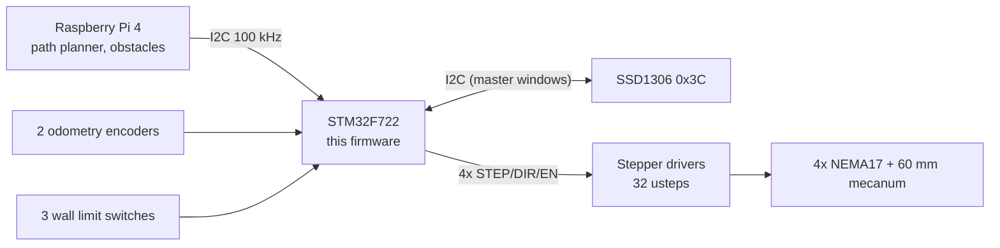

# carte_deplacement_BARE-METAL - STM32F722 mecanum robot controller (FW v3.2)

Bare-metal firmware for an autonomous 4-wheel mecanum robot. The STM32F722RE
board drives 4 NEMA17 steppers (TIM2/3/4/12 + side target timers TIM13/14),
reads 2 odometry encoders (TIM5/TIM8) at 100 Hz, shares one I2C bus with a
Raspberry Pi (path planning / obstacles) and an SSD1306 OLED, and executes a
robust, CRC-protected command protocol (DRIVE, TURN, ARC, QUEUE_ARC, GOTO, STRAFE)
requested by the Pi.
**Author:** Mouadh Jeridi - jeridimouadh@gmail.com
> **FW v3.0** adds full error/event reporting over I2C and a persistent
> settings store: wheel/odometry geometry, speed limits, ramps, gains and
> direction masks are written from the Raspberry Pi, saved in the STM32 flash
> and reloaded at boot. Speeds are u16 mm/s with an absolute ceiling of
> 900 mm/s. See `Docs/07-changelog-v2.md` for the change log.
>
> **FW v3.2** replaces the arc controller with a slip-tolerant P+I curvature
> tracking loop and adds `QUEUE_ARC` (0x17): consecutive arcs are blended, so
> an arc chain runs with a single acceleration and a single deceleration. The
> version register now reports 3.2 - check it from the console to verify a
> flash actually landed (`Docs/07-changelog-v2.md`, entry 16).

---

## Documentation index

| Document | Content |
|---|---|
| `Docs/01-hardware-and-wiring.md` | MCU, clock tree, pin/timer maps, I2C topology, limit switches, HW limits |
| `Docs/02-firmware-architecture.md` | Modules, ISRs + priorities, data flow, state machines, MISRA notes |
| `Docs/03-i2c-protocol-spec.md` | **Wire protocol**: frames, CRC, commands, responses, retries, examples |
| `Docs/04-motion-odometry-and-safety.md` | Motion controllers, ramps, odometry model, calibration, faults, safety |
| `Docs/05-rpi-integration-guide.md` | How to design the Raspberry Pi software (localization, planning, obstacles) |
| `Docs/06-bringup-testing-tuning.md` | Bench bring-up, console calibration, protocol tests, fault injection, tuning |
| `Docs/07-changelog-v2.md` | Release-by-release change log |
| `Docs/08-rgb-led-status.md` | RGB LED colour code, boot animation, LED configuration |
| `RPI/README.md` | **Raspberry Pi companion**: web field console, hybrid planner (line/arc fit + Theta*), Docker deployment |

Start with `01` + `02` to understand the system, read `03` before writing any
RPi code, and keep `05` open while designing the navigation algorithm.

---

## System at a glance



* **I2C address of this board:** 7-bit `0x0A` (OAR1 = 0x14).
* **Clock:** 25 MHz HSE quartz -> PLL -> 216 MHz (HCLK 216 / PCLK1 54 /
  PCLK2 108 MHz, VOS1 + over-drive, 7 flash wait states). All timings are
  derived from the actual timer kernel clocks.
* **Odometry:** two passive encoder wheels (left/right, 170 mm apart),
  0.05 mm/tick, sampled at 100 Hz. **No lateral (Y) odometry exists** - see
  the mecanum limitation note in `Docs/04`.
* **Safety:** wall limit switches stop the robot immediately (hardware-IRQ
  latency), E-STOP command, stall/timeout/deadman supervision, IWDG watchdog,
  safe state on firmware fault. `RELEASE_MOTORS` (fw 3.5) frees the drivers at
  standstill without latching a fault; the next move re-energizes.
* **Raspberry Pi side:** implemented in `RPI/` - a Dockerized FastAPI service
  (I2C protocol v3 client, line/arc fitting, Theta*/A* grid planning, Bezier
  smoothing, velocity profile, calibration console) plus an offline web console (field view, pose
  setting, path drawing, execution supervision, robot calibration). The Pi hotspot serves it at
  `http://192.168.2.30:8080`.

## Quick start (developer)

1. **Build**: open the IAR EWARM project and make sure these are added:
   - `Core/Src/motion.c`, `Core/Src/robot_protocol.c`
   - all `App/Src/*.c` files, with `App/Inc` on the include path
   - `Drivers/STM32F7xx_HAL_Driver/Src/stm32f7xx_hal_iwdg.c` (IWDG module is
     enabled in `stm32f7xx_hal_conf.h`)
2. **Flash** and power the robot **with wheels raised** for the first tests.
3. **Smoke test over I2C from the Pi** (see `Docs/03` for the full frame
   format and a ready-to-use Python class):
   - `PING` -> expect echo + `OK`.
   - `QUERY_STATUS` -> check FW = 3.5, state = IDLE, no faults,
     `cfg_map_version = 1`.
   - `GET_CONFIG` -> readable settings registers (defaults on a fresh board).
   - `DRIVE +200 mm @ 100 mm/s` -> robot moves forward, stops by itself,
     odometry x increases ~ 200 mm.
   - Press a limit switch -> robot stops instantly, status shows fault bit
     `LIMIT`, LED turns red; `CLEAR_FAULTS` re-arms.
   - `QUERY_EVENTS` -> the boot cause and every error/event recorded so far.
4. **OLED**: shows the Charara logo by default. The boot splash retries the
   full SSD1306 init (500 ms for 10 attempts after a failure, then the normal
   10 s back-off), so a display that powers up late or a Pi still holding the
   I2C bus no longer leaves the screen blank. `DISPLAY_TEXT` prints three
   text lines for 10 s in auto mode and the logo then returns; `DISPLAY_MODE
   = manual` keeps text on screen persistently.
5. **RGB LED**: boot colour walk at power-on, then the state colours (idle
   blue, moving green, strafe yellow, fault red, e-stop blinking red) -
   full table in `Docs/08`.

## Repository layout

```
Core/Src/main.c             minimal entry point: init + scheduler
App/Src/robot_app.c         application: init, task steps, scheduler, ISRs
App/Src/robot_board.c       board bring-up (MPU, clock, peripherals, watchdog)
App/Src/robot_i2c.c         I2C dual-role manager + HAL I2C callbacks
App/Src/robot_display.c     OLED logo home screen + RPi messages
App/Src/robot_status.c      RGB LED indication + button events
App/Src/robot_port_baremetal.c  execution environment port (FreeRTOS-ready)
Core/Src/motion.c           motion engine: odometry, ramps, closed loop, safety
Core/Src/robot_protocol.c   I2C protocol: frames, CRC, command execution
App/Inc/robot_configs.h     project configuration (single source of truth)
Drivers/STEPPERS_.../       stepper driver (mm/s API, runtime mechanics)
Drivers/ENCODERS_.../       encoder driver (100 Hz poll, velocity estimate)
Drivers/OLED_.../           SSD1306 driver (finite timeouts, error flag)
Docs/                       documentation set (this index)
Docs/reference/             archived original main.c (CubeMX bring-up source)
RPI/                        Raspberry Pi companion: web console + planner (Docker)
```

Layering rule: `Drivers/` contains project-independent drivers only - their
mechanical data is handed over at runtime (`STEPPERS_MJ_configure()`,
`ENCODERS_MJ_configure()`), while everything robot-specific lives in `App/`.
